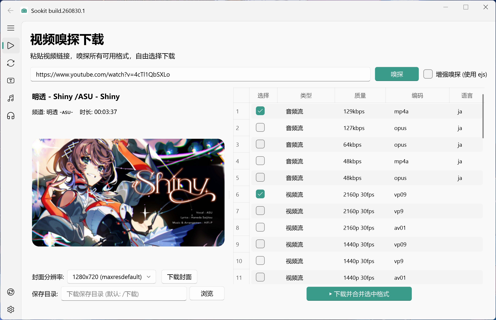

# Sookit

一个 Windows 桌面音视频工具箱

基于 PyQt6 和 [PyQt-Fluent-Widgets](https://github.com/zhiyiYo/PyQt-Fluent-Widgets) 构建

自用，可能会有很多 bug

~~（vibe coding 写出来的玩具罢了）~~

---

## ✨ 功能

- **视频嗅探** — 粘贴链接嗅探视频，格式/画质选择、封面选择下载，支持视频、音频与多语言字幕下载（SRT / TXT / VTT）
- **直播监控** — 监控直播状态
- **字幕烧录** — 将字幕烧录进视频
- **音频提取** — 从视频中提取音轨
- **音频覆盖** — 替换视频音轨
- **任务队列** — 下载任务统一管理与进度显示，支持暂停/续传/取消

## 🚀 安装与运行

### 方式一：安装版（推荐给普通用户）

下载 GitHub Release 中的 `Sookit-Setup-*.exe`，双击安装。安装时可选择「完整安装」（含 FFmpeg 与 yt-dlp/Deno）、「精简安装」（两者都不装）或「自定义安装」（自行勾选组件）。

### 方式二：源码运行

```bash
git clone https://github.com/sodaa-l/Sookit.git
cd Sookit
uv sync          # 安装依赖
uv run sookit    # 启动
```

源码运行需首次到「设置」页一键下载 yt-dlp / deno（安装版的「完整安装」已内置；**已内置时优先使用内置版，仅在无内置版时回退系统 PATH 里的 yt-dlp**）。

ffmpeg / aria2c 不随仓库分发，建议自行下载放到对应目录（**ffmpeg 缺失时会尝试使用系统 PATH 的版本**；aria2c 缺失仅降级为默认下载器，不影响功能）：

- `tools\ffmpeg\`（ffmpeg.exe、ffprobe.exe）
- `tools\aria2c\`（aria2c.exe）

## 字幕下载

在「视频嗅探」中粘贴视频网页链接并嗅探。发现字幕或实时评论后，右侧会出现「音视频 / 字幕」切换；音视频的「默认视图 / 表格视图」改由右上角按钮切换。

- 在「字幕」页搜索语言名或语言码，可同时选择多条字幕；「全选当前筛选」只作用于当前可见项，搜索不会清除已选项。
- SRT、TXT、VTT 可多选，默认 SRT。下载数量按「字幕条数 × 格式数」计算，每条字幕源只下载一次，再在本地导出。
- 自动字幕及自动翻译默认隐藏，可从「更多内容 → 显示自动字幕（含自动翻译）」开启；关闭会清除这些轨道的勾选。仅有自动字幕时也会提供显示入口。
- 实时评论或弹幕从「更多内容 → 下载实时评论…」单独选择，保留站点提供的 JSON / XML 原格式，不参与字幕格式转换。

「平台字幕」表示站点返回的普通字幕，不能保证由人工制作。TXT 会去掉时间轴和标签、保留段落及重复文字；SRT / VTT 导出保留时间轴和正文，不保留原有样式、定位或逐词高亮。源格式不是 SRT / VTT 时，转换需要 FFmpeg。

字幕下载使用产生该结果的嗅探链接。编辑输入框不会把旧字幕下载到新视频；重新嗅探或清空链接后，需要重新选择字幕。下载统一加入任务队列，输出到所选目录。站点未提供的字幕不会自动生成，直接媒体链接也不保证能发现外挂字幕。

## 🖥️ 界面预览



## 📦 数据与资源位置

| 数据              | 位置                                                   |
| --------------- | ---------------------------------------------------- |
| 用户配置 / 任务记录     | `%APPDATA%\Sookit`（config.json、completed_tasks.json） |
| 视频封面缓存          | `%LOCALAPPDATA%\Sookit\covers`                       |
| 运行日志            | `%LOCALAPPDATA%\Sookit\log\sookit.log`               |
| yt-dlp / deno   | 程序目录 `tools\yt-dlp`（安装版可选组件，「完整安装」默认包含；**内置版优先，无内置版时才回退系统 PATH 中的 yt-dlp**）               |
| ffmpeg / aria2c | 程序目录 `tools\`（aria2c 随安装包必装；ffmpeg 为可选组件，「完整安装」默认包含）                                 |

## 📄 许可

本项目基于 **GPL v3** 开源（见 [LICENSE](LICENSE)）
