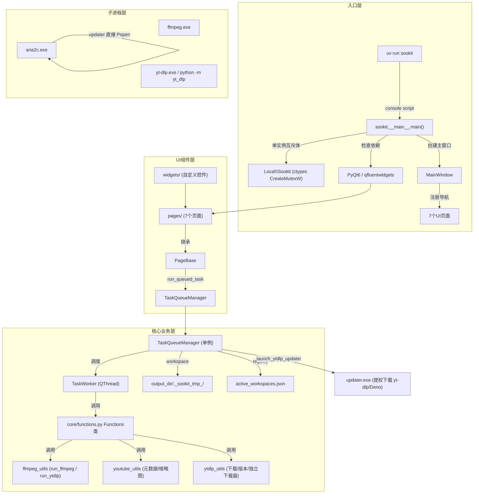

# Sookit 开发文档

面向开发者与 AI 编码助手的快速上手指南，包含架构、模块速查、编码约定、已知坑位与**决策索引**。公开使用说明见 [README](../README.md)。

> 本文件会随代码演进持续维护。架构 / 模块速查 / 编码约定 / 踩坑的改动请同步更新此处；
> **设计决策不写在本文件**——新建 `docs/decisions/NN-slug.md`，并在下方「决策索引」登记一行
> （编号即代码注释里的「决策 NN」，不复用、不改号）。

## 架构总览

```
src/sookit/        代码包 (标准 src 布局)
    │
    ├─ __main__.py        程序入口 (main() — 单实例互斥体 + 依赖检查 + 启动)
    ├─ main_window.py     MainWindow 主窗口 (FluentWindow) + quit_app 清理 + 关闭确认
    ├─ updater.py         独立 GUI 下载器入口 (打包为 updater.exe，提权下载 yt-dlp/Deno)
    ├─ paths.py           统一资源路径定位 (PROJECT_ROOT / APPDATA / LOCALAPPDATA)
    │
    ├─ assets/            静态资源 (960x960.png 应用图标)
    │
    ├─ pages/          UI 页面层 (7 个页面)
    │   ├─ base.py     PageBase 基类 — 拖放、run_queued_task、自动关机
    │   └─ ...         youtube_page (视频嗅探, 类名保留 YouTubePage 但已全站点通用) 等
    │
    ├─ core/           业务逻辑层
    │   ├─ functions.py     Functions 类 — 聚合所有功能接口 + 模块再导出
    │   ├─ task_queue.py    TaskQueueManager (单例) — 任务调度 + workspace + registry
    │   ├─ workers.py       QThread 工作线程 (Worker / TaskWorker / MonitorWorker)
    │   ├─ ffmpeg_utils.py  FFmpeg/yt-dlp/aria2c 路径查找和子进程管理
    │   ├─ ytdlp_utils.py   yt-dlp/Deno 集中管理：版本检查、下载、独立下载器调起
    │   ├─ app_update.py    Sookit 自身自动更新 (原 core/updater.py，2026-09-05 更名避免与顶层 updater.py 混淆)
    │   ├─ youtube_utils.py 元数据提取 + 缩略图构建/通用规范化 (HTTP 降级方案)
    │   ├─ config.py        配置管理 (JSON 缓存 + 线程锁)
    │   ├─ utils.py         滚动条样式等杂项
    │   └─ gif_utils.py     MP4→GIF 自动参数决策转码 (移植自外部脚本，依赖 numpy+Pillow)
    │
    └─ widgets/        可复用 UI 组件层
        ├─ cover_image.py   封面自绘控件
        ├─ combo_box.py     StaticComboBox (单项静态化下拉框)
        ├─ elided_label.py  ElidedLabel (多行省略标签, 1~2 行自适应)
        ├─ infobar.py       show_infobar() 统一提示 (自动分级换行)
        └─ task_card.py     任务卡片 (2 种类型 + 工厂函数 + 封面三级加载)

运行时数据 (不在项目根，见 paths.py)：
    %APPDATA%\Sookit\           config.json、completed_tasks.json、active_workspaces.json、updates/
    %LOCALAPPDATA%\Sookit\      covers/ (封面缓存)、log/ (sookit.log)
    (均有 VIDEOTOOLBOX_* 环境变量覆盖)
tools/                内嵌二进制 (ffmpeg、aria2c；打包态=程序目录，源码态=项目根)
```



## 目录与模块速查

### 核心模块 (`core/`)

| 文件 | 职责 | 关键导出 |
| --- | --- | --- |
| `functions.py` | 功能中枢。聚合所有子模块并再导出保持向后兼容 | `Functions` (类, 所有 func 均为 @staticmethod) |
| `ffmpeg_utils.py` | FFmpeg 路径、子进程执行 (`run_ffmpeg`/`run_ytdlp`)、时长/大小格式化 | `run_ffmpeg()`, `run_ytdlp()`, `check_ffmpeg()`, `extract_video_frame()` |
| `ytdlp_utils.py` | yt-dlp/Deno 版本检查、下载 (aria2c+urllib 双通道)、独立下载器调起 | `download_ytdlp()`, `download_deno()`, `get_*_version()`, `check_ytdlp_deno_update_needed()`, `check_path_ytdlp_update()`, `check_tools_ytdlp_update()`, `launch_ytdlp_updater()` |
| `app_update.py` | **Sookit 自身自动更新** (原 core/updater.py，注意与顶层 updater.exe 入口区分) | `check_latest_version()`, `download_installer()`, `is_newer()` |
| `youtube_utils.py` | YouTube ID 提取、缩略图构建（硬编码 5 档 + 通用规范化）、HTTP 元数据获取 | `extract_youtube_id()`, `build_thumbnails()`, `normalize_thumbnails()`, `fetch_youtube_metadata()` |
| `task_queue.py` | 任务队列单例。进度、workspace 生命周期、active_workspaces registry、JSON 持久化 | `TaskQueueManager`, `Task`, `TaskStatus`, `TaskType`, `_generate_ulid()` |
| `workers.py` | 后台线程: Worker(通用) / TaskWorker(队列, 含 workspace/进程树清理) / MonitorWorker(直播轮询) | `TaskWorker`, `MonitorWorker`, `_kill_process_tree()` |
| `config.py` | JSON 配置文件读写 + 缓存 + 线程锁。主题色、开机自启、下载配置 | `load_config()`, `save_config()`, `load_download_config()` |
| `utils.py` | 滚动条样式、SSL 上下文 | `get_scrollbar_style()`, `get_certifi_ssl_context()` |
| `gif_utils.py` | MP4→GIF 自动参数决策转码（帧率锁死 / 色数 MAE 决策 / 预算内最大化宽度）。依赖 numpy+Pillow（延迟 import） | `convert_to_gif()` |

### 入口与下载器

| 文件 | 角色 |
| --- | --- |
| `__main__.py` | Sookit 主程序入口。`--silent` 静默启动；`_acquire_single_instance()` 单实例互斥体 (Local\Sookit) |
| `updater.py` (顶层) | 独立下载器 GUI，打包为 `updater.exe`。Sookit 用 `launch_ytdlp_updater` 提权调起，结果文件通信 |
| `sookit/core/app_update.py` | Sookit 自身版本检查 + 安装器下载 (原 core/updater.py，与顶层 updater.py 是不同模块) |

### 功能类 `Functions` 方法速查

所有方法均为 `@staticmethod`，**最后一个参数固定为 `log=None`**。下载类方法额外接受 `on_process_created`/`workspace`。

| 方法 | 功能类型 | 依赖 |
| --- | --- | --- |
| `burn_subtitles(video, subtitle, output, encoder, log, on_process_created)` | 字幕烧录 | ffmpeg + libass |
| `replace_audio(...)` | 音频覆盖 | ffmpeg |
| `extract_audio(...)` | 音频提取 | ffmpeg |
| `sniff_youtube(url, log)` | 视频格式嗅探（通用，yt-dlp 支持的站点均可） | yt-dlp |
| `download_youtube(url, format_spec, output_dir, remote, ..., workspace=None)` | 视频下载（通用） | yt-dlp (可选 aria2c) |
| `check_live_status(url, log)` | 直播状态检测 | yt-dlp (降级 HTTP) |
| `sniff_channel(url, log)` | 频道视频列表 | yt-dlp |
| `convert_to_gif(video, output, quality=GifQuality.HIGH, max_mb=None, fps_cap=30, ..., log, on_process_created, on_progress)` | MP4→GIF 自动参数决策转码（四档质量；返回单文件路径；`TaskType.GIF`） | numpy + Pillow + ffmpeg |

> 注：`merge_image_audio` / `batch_merge_image_audio` / `m3u8_to_aac` / `download_xspace` 已随 M3U8 下载、X Space 下载、图片+音频合并三个功能移除（2026-08）。

### 页面 (`pages/`)

所有页面继承 `PageBase(QWidget)`，通过 `run_queued_task()` 加入任务队列。7 个页面：视频嗅探（youtube_page，嗅探/下载/封面/占位符与提示文案均已通用化，仅类名保留 YouTubePage）、直播监控（monitor_page，定位仍是 YouTube 轮询）、字幕烧录、音频覆盖、音频提取、任务队列、设置。

### 自定义组件 (`widgets/`)

| 文件 | 职责 |
| --- | --- |
| `cover_image.py` | `CoverImageWidget` 封面自绘控件（等比缩放 + 圆角，无黑边） |
| `combo_box.py` | `StaticComboBox`：qfluentwidgets ComboBox 子类，仅 1 项时静态显示（点击不弹菜单、不画箭头），≥2 项与原生一致；count 动态判断无需刷新 |
| `elided_label.py` | `ElidedLabel`：多行省略标签（已完成页卡片标题最多两行，超宽末尾加 …，行数 1~2 自适应）；QTextLayout 算截断点 + `fm.elidedText`，注意 UTF-16 偏移换算与字体度量同源（见设计决策 21） |
| `task_card.py` | 任务卡片（2 种类型 + 工厂函数 + 封面三级加载） |
| `infobar.py` | `show_infobar()` 统一提示（见 InfoBar 提示规范） |

## 决策索引

设计决策按编号拆分到 `docs/decisions/NN-slug.md`：编号即代码注释里「见 DEVELOPMENT.md 决策 NN」中的 NN，**不复用、不改号**（老注释无需改动）。
下表「结论」列是本条的硬约束摘要——**只读本文件时也按这一列遵守**；需要来龙去脉（根因、实测数据、排除项）再点开对应文件。

| 编号 | 标题 | 结论（改代码前先看这列） | 文件 |
|---|---|---|---|
| 1 | 字幕烧录：Windows 驱动器冒号问题 | 字幕滤镜必须绕开 `E:` 被误读为选项名（临时 filter_script + 切换工作目录） | [01-subtitle-win-drive-colon.md](decisions/01-subtitle-win-drive-colon.md) |
| 2 | 统一任务队列单例 | 所有任务统一走 `TaskQueueManager` 单例（并发数、暂停/恢复/取消、进度） | [02-unified-task-queue-singleton.md](decisions/02-unified-task-queue-singleton.md) |
| 3 | filter_script 策略 | 复杂滤镜图写临时 `.ff` 文件，用 `-filter_script:v` 读取 | [03-filter-script-policy.md](decisions/03-filter-script-policy.md) |
| 4 | 配置缓存锁 | 配置读走 `_config_cache` + `threading.Lock()` 惰性加载 | [04-config-cache-lock.md](decisions/04-config-cache-lock.md) |
| 5 | 暂停/恢复使用 Windows 原生 API | 挂起/恢复子进程用 Windows 原生 `NtSuspendProcess`/`NtResumeProcess` | [05-pause-resume-win-api.md](decisions/05-pause-resume-win-api.md) |
| 6 | yt-dlp 异常退出码宽容处理 | yt-dlp 退出码非零但产物存在且非空 → 视为成功 | [06-ytdlp-exit-code-tolerance.md](decisions/06-ytdlp-exit-code-tolerance.md) |
| 7 | 封面三级加载策略 (FfmpegTaskCard) | 封面三级加载：内存 `cover_data` → 磁盘缓存 → 异步截帧兜底 | [07-cover-3level-loading.md](decisions/07-cover-3level-loading.md) |
| 8 | 每个 yt-dlp 任务独立 workspace（重要） | **每个 yt-dlp 任务独立 workspace**：先落临时目录，成功后再移到输出目录 | [08-per-task-workspace.md](decisions/08-per-task-workspace.md) |
| 9 | 进程树终止：taskkill /T /F | 取消/超时用 `taskkill /PID <launcher> /T /F` 递归终止整棵进程树 | [09-process-tree-kill.md](decisions/09-process-tree-kill.md) |
| 10 | updater.exe 独立下载器 | 更新下载与主程序解耦为独立 `updater.exe` | [10-updater-exe-downloader.md](decisions/10-updater-exe-downloader.md) |
| 11 | 版本检查走 releases 重定向 | 版本检查走 releases 重定向解析，不用 PyPI JSON API | [11-version-check-redirect.md](decisions/11-version-check-redirect.md) |
| 12 | 单实例互斥体 + 安装/卸载检测 | `Local\Sookit` 互斥体防重复启动；安装/卸载检测 | [12-single-instance-mutex.md](decisions/12-single-instance-mutex.md) |
| 13 | 关闭 Sookit 确认 | 有 RUNNING 任务时关窗必须先弹确认对话框 | [13-close-confirm-dialog.md](decisions/13-close-confirm-dialog.md) |
| 14 | 导航栏展开宽度 | 导航栏展开宽度显式设 250px（qfw 默认 322 偏宽） | [14-nav-expand-width.md](decisions/14-nav-expand-width.md) |
| 15 | 功能裁剪记录（2026-08） | M3U8 / X Space / 图片+音频合并三个功能已移除，勿按旧文档复活 | [15-feature-cut-2026-08.md](decisions/15-feature-cut-2026-08.md) |
| 16 | yt-dlp 更新检查与取消的完善（2026-08） | yt-dlp 更新：检查态与下载态分离、取消中性化、坏 JSON/`.aria2` 残留清理 | [16-ytdlp-update-cancel.md](decisions/16-ytdlp-update-cancel.md) |
| 17 | 封面机制通用化（2026-09-01） | 封面按 extractor 分流：YouTube 走硬编码 5 档（逐字节不变），其余走 `normalize_thumbnails` | [17-cover-generalization.md](decisions/17-cover-generalization.md) |
| 18 | 封面 loader 代际校验（2026-09-01） | 封面回调必须带代际校验（防闪现即消失 / 跨嗅探错配） | [18-cover-loader-generation.md](decisions/18-cover-loader-generation.md) |
| 19 | 封面最终兜底 CoverFallbackWorker（2026-09-01，含 --write-thumbnail 防盗链级） | 封面最终兜底 `CoverFallbackWorker`（403 时走 yt-dlp `--write-thumbnail`） | [19-cover-fallback-worker.md](decisions/19-cover-fallback-worker.md) |
| 20 | StaticComboBox 单项静态化（2026-09-01） | `StaticComboBox`：`count() <= 1` 时不响应鼠标（无意义弹出） | [20-static-combobox-single.md](decisions/20-static-combobox-single.md) |
| 21 | ElidedLabel 多行省略标签与卡片高度自适应（2026-09-01/02） | 卡片标题用 `ElidedLabel`（最多两行 + …），高度自适应 | [21-elided-label-multiline.md](decisions/21-elided-label-multiline.md) |
| 22 | 更新状态 Badge：导航双 badge + 设置页按钮圆点（2026-09-04） | 更新提示 badge/圆点点亮与清除规则；圆点勿贴主题色按钮（会隐形） | [22-update-badges-dots.md](decisions/22-update-badges-dots.md) |
| 23 | 任务队列进入页自动跳转（2026-09-04） | 进任务队列页按「进行中/已完成/皆空」智能定位视图 | [23-queue-auto-switch-view.md](decisions/23-queue-auto-switch-view.md) |
| 24 | 嗅探格式表：同类型互斥勾选 + 预勾选机制 + 默认合并下载（2026-09-05） | 嗅探格式表：同类型互斥勾选 + 预勾选最佳项 + 默认合并下载 | [24-format-table-exclusive-check.md](decisions/24-format-table-exclusive-check.md) |
| 25 | Sookit 自更新：四态检查 + 常驻 InfoBar 取代模态 Dialog（2026-09-05） | Sookit 自更新四态检查 + 常驻 InfoBar 取代模态 Dialog | [25-app-self-update-four-states.md](decisions/25-app-self-update-four-states.md) |
| 26 | 安装包下载移交 updater.exe + sha256 校验（2026-09-05） | 主程序只检查更新，下载与 sha256 校验全交 `updater.exe` | [26-installer-download-sha256.md](decisions/26-installer-download-sha256.md) |
| 27 | updater 点 X 关窗后进程残留：closeEvent ignore 毒化 QDialog 关闭状态（2026-09-05） | `closeEvent` ignore 会毒化 `is_closing` → 收尾必须显式 `QApplication.quit()` | [27-updater-close-event-residue.md](decisions/27-updater-close-event-residue.md) |
| 28 | yt-dlp 按生效来源挂进主窗口更新周期检查（2026-09-06） | yt-dlp（PATH/tools）挂进主窗口周期检查：PATH 只提示、tools 亮 badge | [28-ytdlp-source-periodic-check.md](decisions/28-ytdlp-source-periodic-check.md) |
| 29 | MP4 → GIF 自动参数决策转码（2026-10-06） | MP4→GIF 内核 `core/gif_utils.py` 自动决策参数，四档质量 | [29-mp4-gif-auto-params.md](decisions/29-mp4-gif-auto-params.md) |
| 30 | 「动图下载」页接 UI + 自定义编码质量（2026-10-07） | 「动图下载」页接 UI + 自定义编码质量（默认不做嗅探，直接入队） | [30-gif-page-ui.md](decisions/30-gif-page-ui.md) |
| 32 | 路径输入清洗 + InfoBar 定位守卫（2026-10-11） | 路径输入框统一 `read_path()` 洗引号；InfoBar `_settle` 守卫须吞 KeyError | [32-path-sanitize-infobar.md](decisions/32-path-sanitize-infobar.md) |
| 33 | HLS（m3u8）流改用 ffmpeg 下载（2026-10-11） | **HLS(m3u8) 必须走 `--hls-prefer-ffmpeg`**（hlsnative 直拼的 TS 带无时间戳包，mkv 合并必失败） | [33-hls-prefer-ffmpeg.md](decisions/33-hls-prefer-ffmpeg.md) |
| 34 | 下载失败时的诊断回放（2026-10-11） | `run_ytdlp(diagnostics=True)`：失败时回放 `-v` 尾部（含 ffmpeg stderr） | [34-ytdlp-diagnostics.md](decisions/34-ytdlp-diagnostics.md) |
| 35 | 嗅探页「下载封面」文件名归属（2026-10-13） | 封面文件名只能取「当前面板所属视频」：嗅探中用链接 ID、完成后用标题；开始新嗅探即作废旧标题/频道/时长 | [35-cover-filename-owner.md](decisions/35-cover-filename-owner.md) |
| 36 | 关闭 yt-dlp 格式探测（2026-10-13） | 下载命令固定加 `--no-check-formats`：新视频 HLS 的「探测失败即弃用格式」会让一次抖动整单失败，且该探测走 Python ssl（不吃 `--hls-prefer-ffmpeg`） | [36-no-check-formats.md](decisions/36-no-check-formats.md) |

## AI 编码约定

### 环境

```bash
# 所有 Python 命令必须通过 uv run 执行
uv run python script.py
```

Windows 中文环境 GBK 代码页：Python 文件 I/O 显式 `encoding="utf-8"`，必要时 `PYTHONUTF8=1`。

### 页面开发模式

```python
class MyNewPage(PageBase):
    def __init__(self, parent=None):
        super().__init__(parent)
        self._drop_target = qfw.LineEdit()  # 注册拖放目标

    def _start_action(self):
        # 加入任务队列 (不要直接创建 Worker)
        self.run_queued_task(
            func=Functions.some_method,
            args=(arg1, arg2, arg3, 'software'),  # 最后一个参数留给 log
            task_type=TaskType.FFMPEG,
            title=f"操作 - {filename}",
            metadata={'filename': filename, 'input_video': video_path, 'out': output_path}
        )
```

### Functions 方法规范

- 所有耗时操作为 `@staticmethod`，最后一个参数 `log=None`。
- 通过 `run_ffmpeg(cmd, log, None, on_process_created)` 或 `run_ytdlp(cmd, log, process_ref, on_process_created, on_path)` 执行子进程。
- **不要直接调用 `subprocess.Popen`**（用 run_ffmpeg/run_ytdlp 统一管理）。
- 下载类方法接受 `workspace` 参数（非 None 时 `-o` 指向 workspace）。

### 子进程参数约定（重要）

- `run_ffmpeg(cmd, log, process_ref=None, on_process_created=None)`：ffmpeg 进程经 `on_process_created` 暴露，供 TaskWorker 取消时 taskkill。
- `run_ytdlp(cmd, log, process_ref=None, on_process_created=None, on_path=None)`：
  - 内部加 `--encoding utf-8`（强制 yt-dlp 输出 UTF-8，避免中文路径乱码）和 `--print-to-file after_move:filepath`。
  - **返回值是列表**：按行收集多个最终输出路径（支持 `-f '137,140'` 多文件）。
  - 签名保留 `on_path`，但 `download_youtube` 当前**不传** on_path（output_files 靠 `--print-to-file` 返回列表）。
- `ytdlp_utils._download_file_with_aria2c` 用**reader 线程 + queue.get(timeout=0.2)** 非阻塞读 stdout（取消不被 read 阻塞），`on_proc(proc)` 暴露 aria2c。

### 下载取消检查点（重要）

所有可取消的下载流程（`download_ytdlp`/`download_deno`/`_download_file`）通过 `_raise_if_cancelled(cancel_cb)` 在**各阶段之间**插入检查点：

- 函数入口、本地版本查询后、最新版查询后、启动下载进程前各一个；
- 消除"版本检查阶段"的取消盲区（网络超时 20s + `--version` 子进程 20s，两个组件最坏 ~60s 内取消无响应）；
- `_download_file` 入口检查点保证取消后**不会启动新的 aria2c/urllib 进程**；
- `_version_from_latest_url` 超时 20s（国内直连 GitHub TLS 握手偶发超 10s，过短会误判"已最新"静默跳过更新）。

### metadata 结构约定

| 字段 | 用途 | 必填 |
| --- | --- | --- |
| `filename` | 任务显示名称 | 是 |
| `input_video` / `input_img` | FfmpegTaskCard 封面加载 | 推荐 |
| `out` | CompletedThumbnailCard 打开文件/文件夹 | 推荐 |
| `cover_data` (bytes) | 封面二进制数据 | 可选 |

### 线程安全

- **不要**直接访问 `TaskQueueManager` 的 `active_tasks` / `completed_tasks` 内部 dict — 使用 `get_active_tasks()` / `get_completed_tasks()`。
- **不要**跨线程操作 Qt 控件 — 使用 `pyqtSignal`。

### InfoBar 提示规范（重要）

- **新增 InfoBar 提示一律使用 `show_infobar()`**（`sookit/widgets/infobar.py`），**不要直接调用 `qfw.InfoBar.*`**：

  ```python
  from sookit.widgets.infobar import show_infobar
  show_infobar(self, "error", title="检查更新失败", content=..., duration=-1)
  ```

- 函数按 **title 与 content 任一**的**实际渲染宽度**自动分级（2026-10-07 起 title 也参与判定）：两者都不超 560px 时保持原生单行（Horizontal）；任一超过则重建为竖排（Vertical），**title 与 content 各自**做标点优先贪心换行（`，。；：！？、` 后为首选断点，无标点长段二分硬断）+ 固定宽度与精确高度。竖排布局下两者天然上下排列，不会挤在同一行。阈值常量 `WRAP_THRESHOLD = 560`，可用 `wrap_max_width` 参数覆盖。
- 需要挂自定义控件（按钮等）时用返回值：`bar = show_infobar(...); bar.addWidget(btn)`。
- 背景（三个坑，终版方案逐一解决）：
  1. qfluentwidgets 内置换行按"父窗口宽/9"的**字符数**（上限 120）硬换行，而中文字符显示宽度约为 ASCII 两倍——长中文文案实际不换行、单行撑爆 InfoBar（实测比 1131px 窗口还宽）；
  2. wordWrap QLabel 的 sizeHint 高度仍按单行算，且布局会**垂直压缩 label**（行距挤压、文本截断）——**高度必须在 label 层解决**：`fontMetrics.boundingRect(0, 0, 宽, 10000, TextWordWrap, text)` 精确计算后 `label.setMinimumHeight()`，bar 层的 setMinimumHeight 补偿治标不治本（bar 高了 label 仍被压）；
  3. 换行后需同步 `bar.content = wrapped`：窗口 resize 时库的 `_adjustText` 会用 TextWrap 重排 `self.content`，其对含 `\n` 文本逐行处理不破坏已有换行（已从源码确认 + resize 实测）；**title 同理**（`bar.title = wrapped`），否则 resize 会把标题 TextWrap 回单行；
  4. **只判 content 会漏掉长标题**（2026-10-07 实测）：任务失败条的 title 是整条推文文本（渲染宽 1092px），而 content 仅 336px，旧判定放行走原生单行版 → 条宽 1539px **比页面 1082px 还宽**，横跨页面顶部把「进行中/已完成」segment 遮住；现在 title/content 一起判定、一起折行，条宽收敛到 663px 落在右上角。
- 初始宽度可能偏大（QSS 字体 polish 前的 sizeHint 偏大，实测 679 → 557），封装内已加事件循环后二次 `adjustSize` 收缩（`_settle`，singleShot 0/100ms）。
- **宽度收缩后必须重算位置**：`InfoBarManager` 在 `show()` 瞬间按当时偏大的宽度算定 x（`parentW - barW - margin`），此后 InfoBar 自身宽度变化**不会**触发重定位（库只在父窗口 resize / 其他条关闭时重算），右侧会出现「收缩量 + margin」的大段空隙（实测 146px，期望 24px）。`_settle` 在收缩后经 `InfoBarManager.make(bar.position)._pos(bar)` 重算位置；滑入动画（200ms）运行中须改 `slideAni` 的 endValue 而非直接 `move`（会被动画逐帧覆盖）。
- 换行分支会 `replace("\n", "")` 后按标点重新断行，故长文案中 `\n` 不产生换行、**标点才是断点**——需要在此处断行时（如安装器路径后）确保文案里有标点。
- **任务失败提示按发起页过滤**（2026-10-07）：`task_failed` 是全局信号，回调里必须先判 `task.task_id in self._owned_task_ids`（`PageBase.run_queued_task` 自动登记），否则**别的页面的任务失败会在本页弹条**（实测动图任务失败同时在嗅探页弹出）。`youtube_page` / `gif_page` 均按此过滤，`queue_page` 作为全局视图有意不过滤，`monitor_page` 另有 `_monitor_id_by_queue` 映射过滤。

### 导入规范

```python
from sookit.core.functions import Functions, check_ffmpeg, run_ffmpeg
from sookit.core.task_queue import TaskType, TaskQueueManager
from sookit.pages.base import PageBase
```

### 新增代码时注意

- **给 subprocess 命令插参数**：必须插在可执行路径 `cmd[0]` **之后**（`cmd_list[:1] + [...] + cmd_list[1:]`），否则 Popen 把参数当程序名。
- **修改 Task/Workspace**：新增下载任务时确认 Task 有 `output_dir`/`workspace`/`output_files`，workspace 由 TaskQueueManager 管理，Worker 不拥有。
- **版本号**：升版三处同步（`__init__.py` APP_VERSION、`pyproject.toml` version、`installer.iss` MyAppVersion），详见[打包与发布](#打包与发布)。

## 打包与发布

### 版本号规范

格式 `YYMMDD.N`（如 `260827.1`）：日期 + 当天递增序号（当天首个版本 N=1）。升版时**三处同步**：

| 文件 | 字段 | 示例 |
| --- | --- | --- |
| `src/sookit/__init__.py` | `APP_VERSION`（带 `build.` 前缀） | `"build.260827.1"` |
| `pyproject.toml` | `[project] version` | `"260827.1"` |
| `packaging/installer.iss` | `#define MyAppVersion` | `"260827.1"` |

**发布 Release 的 tag 命名（重要）**：tag 必须用**带 `build.` 前缀**的完整版本号（如 `build.260827.1`，
与 `APP_VERSION` 一致）。原因：`core/app_update.py` 的 `is_newer` 日期版比较要求远程 tag 带 `build.` 前缀，
否则纯数字 `260827.1` 会被当作语义化版本、每次启动都误报「发现新版本」。release 的 **asset 直接上传
`installer.iss` 产物原样**（`Sookit-Setup-260827.1.exe`，不带 `build.` 前缀）；`download_installer` 下载时会
自动剥离 `build.` 前缀拼资产名/本地文件名，两者正好对上
（URL：`releases/download/build.260827.1/Sookit-Setup-260827.1.exe`）。

### 打包流程

```bash
# 1. PyInstaller onedir 构建（Sookit.exe 与 updater.exe 共享同一 _internal，避免体积翻倍）
uv run pyinstaller --noconfirm packaging/sookit.spec

# 2. 复制外部工具到产物目录（CI 由 release.yml 下载 ffmpeg/aria2c/yt-dlp/Deno；
#    本地流程从 tools/ 拷贝：aria2c、ffmpeg 必需，yt-dlp/Deno 需自备——跑过一次 app 的
#    「下载/更新」后 tools/yt-dlp/ 即存在；installer.iss 引用了该目录，缺失会导致 ISCC 编译失败）
mkdir -p dist/Sookit/tools && cp -r tools/aria2c tools/ffmpeg tools/yt-dlp dist/Sookit/tools/

# 3. Inno Setup 编译安装包（scoop 安装的 ISCC 经 shims 调用）
/d/scoop/shims/ISCC.exe packaging/installer.iss
```

产物：`dist/Sookit-Setup-<版本>.exe`（安装包）；`dist/Sookit/`（onedir 目录，可先直接运行验证再编译安装器）。

### 安装器行为要点（installer.iss）

- 仅简体中文界面（`ChineseSimplified.isl` 已入库，来自官方 issrc 仓库 `Files/Languages/`）。
- 默认安装到 `{autopf}\Sookit`；**父路径可自选，末级目录强制为 Sookit**：`[Code] NextButtonClick(wpSelectDir)` 检测所选目录最后一级非 Sookit 时自动追加 `\Sookit`（如 `D:\Apps` → `D:\Apps\Sookit`，盘符根 `D:\` → `D:\Sookit`；不区分大小写、不会重复追加）。限制：静默安装 `/VERYSILENT /DIR=` 不显示向导页，不走该回调，无法校验。
- `AppMutex=Local\Sookit`：安装/卸载时检测 Sookit 是否在运行，弹窗询问（不自动关闭）。
- 卸载删除整个 `{app}`（含可选组件 `tools\yt-dlp`、`tools\ffmpeg` 与 updater 运行时产物）及 `%APPDATA%\Sookit`、`%LOCALAPPDATA%\Sookit` 用户数据。
- **安装类型与可选组件**：`[Types]` 定义三项——`完整安装`（首位，即默认）、`精简安装`、`自定义安装`；`[Components]` 定义 `ffmpeg`（FFmpeg 音视频组件，解压后约 193 MB）与 `ytdlp`（yt-dlp + Deno，约 110 MB），两者均标 `Types: full`，即只有「完整安装」默认勾选，精简与自定义下默认都不勾、由用户决定。**`自定义安装` 必须带 `Flags: iscustom`**：官方文档明确「如果没有定义自定义类型，Setup 将只允许用户选择预设安装类型，用户将不能再手动选择/取消选择组件」——手动勾选能力完全依赖这个标志。两个组件都不加 `fixed`，用户始终可改；一旦改动，向导的安装类型会自动切到「自定义」。这套三选一**只在全新安装出现**，升级安装会跳过该页（见下条）。取消勾选**不会**删除已装的对应文件（Inno 默认行为，仅弹一句提示）。补充：不勾 `ytdlp` 可在设置页「下载/更新」补装；不勾 `ffmpeg` **没有 app 内下载入口**，用户只能自行放入 `tools\ffmpeg\` 或依赖系统 PATH。
- **全新安装 vs 升级安装的分流（`[Code]`）**：升级安装时 `ShouldSkipPage(wpSelectComponents)` 返回 True，用户不再面对三选一，两个组件改由闸门自动决定。升装判定 `IsUpgradeInstall()` 查**卸载注册表键** `Software\...\Uninstall\{#MyAppRegKey}`（`#define MyAppRegKey` = AppId 去一层大括号 + `_is1`，键名已实测确认），并**四处全查**：`HKLM`、`HKLM32`、`HKLM64`、`HKCU`，任一处命中即判升装。四处全查是必须的，不是保险起见——实测（探针4）四个常量运行时都可用，但 **`HKLM` 读到的是 32 位视图**（与 `HKLM32` 同值、与 `HKLM64` 不同值），而管理员 + `ArchitecturesInstallIn64BitMode` 的安装会写到 **64 位视图**，只查 `HKLM` 会漏掉、功能静默失效。管理员写入的具体视图未做端到端实测（需 UAC 交互），但四处全查已使其与结论无关。**不能用「`{app}\Sookit.exe` 是否已存在」来判**：`[Files]` 按声明顺序安装，主条目先写 `Sookit.exe`，轮到组件条目时它已存在，全新安装会被误判成升装（已实测踩过）。反过来的坑同样实测踩过：**全新安装前该键必须不存在**，否则会被静默判成升装而"不装组件"。
- **`[Code]` 段注释必须用 `//` 或 `{ }`，不能用 `;`**：该段是 Pascal 源码，`;` 是语句结束符，写在行首会在编译时报 `'BEGIN' expected`（已踩过一次）。注意 `{ }` 注释里不能再出现 `}`，所以正文提到 `{app}` 这类常量时要用 `//` 行注释。
- **随包内置的外部工具**（CI 取 GitHub 滚动 latest，与 app 内运行时更新同源 URL）：`yt-dlp.exe`、`deno.exe` 装到 `{app}\tools\yt-dlp\`，`ffmpeg.exe`、`ffprobe.exe` 装到 `{app}\tools\ffmpeg\`，装完即用、无需首次到设置页手动下载。构建因此不可复现、无法固定 sha256，出厂版本仅作基线，后续由 app 内「下载/更新」前移。生效来源仍是 PATH > tools（PATH 里已有 yt-dlp 的用户不受影响）。
- **升级覆盖策略：三层机制各司其职（易踩）**：① 主 `[Files]` 用 `Excludes: "\tools\yt-dlp\*,\tools\ffmpeg\*"`（前导反斜杠锚定源树根，逗号分隔多模式）把两个可选组件目录排除，避免主条目的 `ignoreversion` 无条件覆盖它们；② 两条组件条目各带 `Check: PatchIfPresent('<目录主文件>')` 作**升装闸门**——全新安装恒放行，升级安装仅当该主文件已存在才放行，于是"上次没装"的组件不会被新增（实测：整删 `tools\yt-dlp` 后升级，两个文件都不会装回）；③ 已放行的文件**刻意不带任何 flag**（不用 `ignoreversion`、也不用 `onlyifdoesntexist`），交给 Inno 默认规则按 PE 版本信息比较：已存在文件版本更新才覆盖、相同或更新则保留——既不会把用户已通过设置页更新过的 yt-dlp/deno 打回旧版，又能在安装包内版本更新时自动刷新。前提是这些 exe 带 VS 版本资源，已实测（yt-dlp `2026.08.19` → `2026.8.19.0`、deno `2.9.7` → `2.9.7.0`，数值单调可比，不会踩 `"10" < "9"` 的字符串比较坑）。
- **闸门必须判「文件」、不能判「目录」**：主条目的 `createallsubdirs` 会把 `tools\ffmpeg`、`tools\yt-dlp` 两个**空目录**也建出来（`Excludes` 只排文件、不排目录——实测 `/TYPE=compact` 不装任何组件时这两个空夹依然出现）。所以 `DirExists(...)` 在 Check 求值时恒为 True、闸门形同虚设，会把 100+MB 组件重新塞给从没装过的用户；这正是必须改成 `FileExists('<目录主文件>')` 的原因。副作用：精简安装也会留下这两个空目录，功能上无影响（app 侧判的是文件是否存在），暂不处理。
- ISCC 编译时的 `PrivilegesRequired=admin + per-user areas` 警告为已知行为：多账户场景下若用另一管理员凭据提权，`{userappdata}`/`{localappdata}` 会解析到提权账户而非实际使用者（仅数据残留，不影响功能）；单管理员场景无影响，维持现状不加 `UsedUserAreasWarning=no` 压制。

## 已知踩坑备忘录

| 问题 | 根因 | 解决方案 |
| --- | --- | --- |
| `E:` 被 subtitles 滤镜当选项名 | Windows 驱动冒号被选项解析器拆分 | `os.chdir` + 相对路径文件名 |
| QThread 被 GC 导致崩溃 | 取消 worker 后 QThread 对象被回收 | `_cancelling_workers` 保留引用 |
| 暂停/恢复无效 | Windows 无 posix signal | `NtSuspendProcess` 原生 API |
| yt-dlp 退出码非零但下载成功 | ffmpeg 合并阶段报错 | 检查文件存在即视为成功 |
| JSON 损坏丢失历史 | 写文件过程中断 | 自动备份 `.bak` |
| yt-dlp 中文路径乱码 | Windows GBK 输出, 按 UTF-8 解码 | `run_ytdlp` 加 `--encoding utf-8` |
| `--encoding` 插错位置 | 插在 cmd[0] 之前被当程序名 | `cmd_list[:1] + ['--encoding','utf-8'] + cmd_list[1:]` |
| `.part` 删不掉 | 取消删精确路径不覆盖 `.part-FragN`/`.ytdl` 命名 | workspace 方案，删整个目录 |
| aria2c 取消后残留 | `proc.stdout.read` 阻塞，取消检查无法及时 kill | reader 线程 + queue.get(timeout) + force_terminate 兜底 |
| aria2c 403 (YouTube) | IP/节点被限流，非代码问题 | 换节点；非反爬规避 |
| 多任务写同一 `.part` 冲突 | 同一 url+out_dir 两个任务 | `_find_duplicate` 防重复 |
| 安装/卸载时文件占用删不掉 | 卸载时程序运行 | 单实例互斥体 + AppMutex |
| 卸载删不掉 tools\yt-dlp | updater 运行时产物不在卸载记录 | `[UninstallDelete]` 删整个 `{app}` |
| 异常退出残留 workspace | 进程被杀中断下载，临时目录未清理 | active_workspaces registry 启动清理 |
| updater 取消时静默崩溃无结果 | done/finished→deleteLater 与 QTimer 回调竞态，访问已删 QThread 抛 RuntimeError | 不连 deleteLater + `_thread_alive()` 防御（RuntimeError 按线程已结束处理） |
| InfoBar 换行文本行距压缩/截断 | wordWrap QLabel sizeHint 高度按单行算，布局垂直压缩 label | label 层精确高度（fontMetrics boundingRect）+ setFixedWidth 钉死宽度 |
| 重打包后 updater 回退 urllib | 打包只跑 pyinstaller 漏了复制 tools，aria2c 缺失 | 打包两步：pyinstaller + 复制 tools/aria2c ffmpeg |
| UAC 提权进程不继承环境变量 | runas 启动重建环境块 | 测试时 Sookit 侧迁就 updater 的 frozen 路径解析（VIDEOTOOLBOX_TOOLS_DIR 指向其 tools） |
| 长中文文案撑爆 InfoBar | 库内置换行按字符数（上限 120）算，中文显示宽度≈ASCII 两倍 | 统一走 `show_infobar()`，按渲染宽度自动换行 |
| InfoBar 弹出瞬间整体左偏（右侧空隙过大） | manager 在 show 瞬间按偏大宽度算定 x，之后宽度收缩不触发重定位 | `_settle` 收缩后经 manager 重算位置（slideAni 运行中改 endValue，结束后直接 move） |
| qfluentwidgets ComboBox `currentData()` 恒为 None | `addItem(text, icon=None, userData=None)` 位置传参第二参是 icon，URL 落进 icon 形参 | `addItem(label, userData=url)` 关键字传参 |
| 封面出现后瞬间消失/跨嗅探错配 | 晚到的 loader 失败无差别 clearPixmap（无代际校验）+ 补载只看 isNull 造成同 URL 并发 | 回调带 worker 身份丢弃过期结果 + 补载前查 isRunning（见设计决策 18） |
| 封面"能下载不能显示" | 封面是 Qt 不支持的格式（AVIF/HEIC 等），下载纯写字节不解码 | AVIF 等放弃（占位+日志报格式）；防盗链 403 走 yt-dlp --write-thumbnail 兜底（见设计决策 19） |
| `--print after_move:filepath` 与 --write-thumbnail 组合无输出 | --print 隐含 simulate，after_move 阶段不触发 | 固定 `-o` 模板 + 遍历产物文件（产物名可预测） |
| QThread.run 内操作 QPixmap 崩溃/不可靠 | QPixmap/QGui 类仅主线程可用 | 工作线程内用 QImage 判断解码，主线程再转 QPixmap |
| B 站短时重复请求 412 / x.com SSL 间歇被重置 | 站点风控 / 直连干扰 | 间隔数秒重试即可，非代码问题 |
| GIF 日志里的 `✓`/`✗` 在 GBK 控制台抛 UnicodeEncodeError | 两字符不在 GBK 字符集，`print`/`logging` 按 cp936 编码 | 日志统一用纯中文/ASCII，不用符号标记；注意本机 `PYTHONUTF8=1` 会掩盖此问题，须在未设该变量的环境下验证（`≤`/`→`/`×` 等在 GBK 内可用） |
