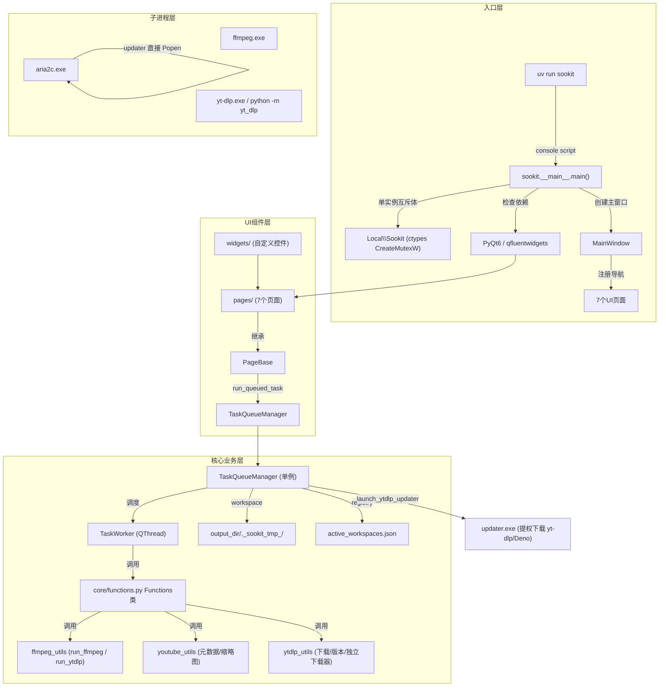

# Sookit 开发文档

面向开发者与 AI 编码助手的快速上手指南，包含架构、模块速查、编码约定、已知坑位与**决策索引**。公开使用说明见 [README](../README.md)。

> 本文件会随代码演进持续维护。架构 / 模块速查 / 编码约定 / 踩坑的改动请同步更新此处；
> **设计决策不写在本文件**——新建 `docs/decisions/NN-slug.md`，并在下方「决策索引」登记一行
> （编号即代码注释里的「决策 NN」，不复用、不改号）。

## 架构总览

```
src/sookit/        代码包 (标准 src 布局)
    │
    ├─ __main__.py        程序入口 (main() — 单实例互斥体 + 依赖检查 + 启动)
    ├─ main_window.py     MainWindow 主窗口 (FluentWindow) + quit_app 清理 + 关闭确认
    ├─ native_host.py     Chrome Native Messaging 独立入口（决策 62）
    ├─ updater.py         独立 GUI 下载器入口 (打包为 updater.exe，提权下载 yt-dlp/Deno)
    ├─ paths.py           统一资源路径定位 (PROJECT_ROOT / APPDATA / LOCALAPPDATA)
    │
    ├─ assets/            静态资源 (960x960.png 应用图标)
    │
    ├─ pages/          UI 页面层 (7 个页面)
    │   ├─ base.py     PageBase 基类 — 拖放、run_queued_task、自动关机
    │   └─ ...         youtube_page (视频嗅探, 类名保留 YouTubePage 但已全站点通用) 等；gif_page (X 动图/视频 → GIF，决策 44)
    │
    ├─ core/           业务逻辑层
    │   ├─ functions.py     Functions 类 — 功能中枢 + 少量仍在用的聚合入口（非兼容层）
    │   ├─ task_queue.py    TaskQueueManager (单例) — 任务调度 + workspace + registry
    │   ├─ workers.py       QThread 工作线程 (Worker / TaskWorker / MonitorWorker)
    │   ├─ ffmpeg_utils.py  FFmpeg/yt-dlp/aria2c 路径查找和子进程管理
    │   ├─ ytdlp_utils.py   yt-dlp/Deno 集中管理：版本检查、下载、独立下载器调起
    │   ├─ app_update.py    Sookit 自身自动更新 (原 core/updater.py，2026-09-05 更名避免与顶层 updater.py 混淆)
    │   ├─ youtube_utils.py 元数据提取 + 缩略图构建/通用规范化 (HTTP 降级方案)
    │   ├─ sniff_options.py 嗅探页默认视图档位归并 + 容器族判定 (纯函数，决策 47)
    │   ├─ subtitle_utils.py 字幕/评论轨道归一、单次获取、多格式导出及严格产物验收 (决策 61)
    │   ├─ config.py        配置管理 (JSON 缓存 + 线程锁)
    │   ├─ utils.py         滚动条样式（含全局滚动条补丁，决策 48）等杂项
    │   └─ gif_utils.py     MP4→GIF 自动参数决策转码 (移植自外部脚本，依赖 numpy+Pillow)
    │
    └─ widgets/        可复用 UI 组件层
        ├─ cover_image.py   封面自绘控件
        ├─ combo_box.py     StaticComboBox (单项静态化下拉框)
        ├─ elided_label.py  ElidedLabel (多行省略标签, 1~2 行自适应)
        ├─ infobar.py       show_infobar() 统一提示 (自动分级换行)
        ├─ option_row.py    OptionRow 单选档位行 (嗅探页默认视图, 决策 47)
        ├─ option_grid.py   OptionFlowLayout 一至两列自适应网格 (决策 47)
        ├─ subtitle_panel.py 字幕筛选/多选/格式选择 + 独立评论对话框 (决策 61)
        └─ task_card.py     任务卡片 (2 种类型 + 工厂函数 + 封面三级加载)

运行时数据 (不在项目根，见 paths.py)：
    %APPDATA%\Sookit\           config.json、completed_tasks.json、active_workspaces.json、updates/
    %LOCALAPPDATA%\Sookit\      covers/ (封面缓存)、log/ (sookit.log)
    (均有 VIDEOTOOLBOX_* 环境变量覆盖)
tools/                内嵌二进制 (ffmpeg、aria2c；打包态=程序目录，源码态=项目根)
```



## 目录与模块速查

### 核心模块 (`core/`)

| 文件 | 职责 | 关键导出 |
| --- | --- | --- |
| `functions.py` | 功能中枢（`Functions` 类）。**不是兼容层**——只从子模块引入本文件要用的函数，以及页面仍在使用的少量聚合入口；新增代码应直接从源模块 import（见设计决策 41） | `Functions` (类, 所有 func 均为 @staticmethod) |
| `ffmpeg_utils.py` | FFmpeg 路径、子进程执行 (`run_ffmpeg`/`run_ytdlp`)、时长/大小格式化 | `run_ffmpeg()`, `run_ytdlp()`, `check_ffmpeg()`, `extract_video_frame()` |
| `ytdlp_utils.py` | yt-dlp/Deno 版本检查、下载 (aria2c+urllib 双通道)、独立下载器调起 | `download_ytdlp()`, `download_deno()`, `get_*_version()`, `check_ytdlp_deno_update_needed()`, `check_path_ytdlp_update()`, `check_tools_ytdlp_update()`, `launch_ytdlp_updater()` |
| `app_update.py` | **Sookit 自身自动更新** (原 core/updater.py，注意与顶层 updater.exe 入口区分) | `check_latest_version()`, `download_installer()`, `is_newer()` |
| `youtube_utils.py` | YouTube ID 提取、缩略图构建（硬编码 5 档 + 通用规范化）、HTTP 元数据获取 | `extract_youtube_id()`, `build_thumbnails()`, `normalize_thumbnails()`, `fetch_youtube_metadata()` |
| `sniff_options.py` | 嗅探页默认视图的档位归并 + 合并容器族判定（纯函数、无 Qt，决策 47） | `build_view_options()`, `is_standard_pair()` |
| `subtitle_utils.py` | 字幕/评论轨道分类、每轨单次下载、SRT/TXT/VTT 导出、严格清单校验（决策 61） | `build_subtitle_tracks()`, `download_subtitles()`, `download_comments()` |
| `browser_protocol.py` | 浏览器消息帧、YouTube 单视频白名单、固定扩展 ID（决策 62） | `normalize_video_url()`, `validate_request()`, `encode_message()`, `decode_message()` |
| `browser_ipc.py` | 当前用户/会话的 Qt 本机通道；GUI 线程分发、退出清理（决策 62） | `BrowserRequestServer`, `send_request()` |
| `browser_diagnostics.py` | 只读核对扩展资源、host 清单/程序与 Chrome 注册路径（决策 62） | `get_extension_dir()`, `get_expected_host_manifest()`, `read_registry_entries()`, `diagnose_browser_components()` |
| `task_queue.py` | 任务队列单例。进度、workspace 生命周期、active_workspaces registry、JSON 持久化 | `TaskQueueManager`, `Task`, `TaskStatus`, `TaskType`, `_generate_ulid()` |
| `workers.py` | 后台线程: Worker(通用) / TaskWorker(队列, 含 workspace/进程树清理) / MonitorWorker(直播轮询) | `TaskWorker`, `MonitorWorker`, `_kill_process_tree()` |
| `config.py` | JSON 配置文件读写 + 缓存 + 线程锁。主题色、开机自启、下载配置、浏览器扩展开关 | `load_config()`, `save_config()`, `load_browser_extension_enabled()`, `save_browser_extension_enabled()`, `load_download_config()` |
| `utils.py` | 平滑滚动参数、SSL 上下文、**全局滚动条外观补丁**（决策 48：常显极淡、悬停恢复原生浓度） | `set_smooth_scroll_params()`, `get_certifi_ssl_context()`, `apply_global_scrollbar_style()` |
| `gif_utils.py` | MP4→GIF 自动参数决策转码（帧率锁死 / 色数 MAE 决策 / 预算内最大化宽度）。依赖 numpy+Pillow（延迟 import） | `convert_to_gif()` |

### 入口与下载器

| 文件 | 角色 |
| --- | --- |
| `__main__.py` | Sookit 主程序入口。`--silent` 静默启动；`_acquire_single_instance()` 单实例互斥体 (Local\Sookit) |
| `updater.py` (顶层) | 独立下载器 GUI，打包为 `updater.exe`。Sookit 用 `launch_ytdlp_updater` 提权调起，结果文件通信 |
| `sookit/core/app_update.py` | Sookit 自身版本检查 + 安装器下载 (原 core/updater.py，与顶层 updater.py 是不同模块) |

### 功能类 `Functions` 方法速查

所有方法均为 `@staticmethod`，**最后一个参数固定为 `log=None`**。下载类方法额外接受 `on_process_created`/`workspace`。

| 方法 | 功能类型 | 依赖 |
| --- | --- | --- |
| `burn_subtitles(video, subtitle, output, encoder, log, on_process_created)` | 字幕烧录 | ffmpeg + libass |
| `replace_audio(...)` | 音频覆盖 | ffmpeg |
| `extract_audio(...)` | 音频提取 | ffmpeg |
| `sniff_youtube(url, log)` | 视频格式嗅探（通用，yt-dlp 支持的站点均可） | yt-dlp |
| `download_youtube(url, format_spec, output_dir, remote, ..., workspace=None)` | 视频下载（通用） | yt-dlp (可选 aria2c) |
| `check_live_status(url, log)` | 直播状态检测 | yt-dlp (降级 HTTP) |
| `sniff_channel(url, log)` | 频道视频列表 | yt-dlp |
| `convert_to_gif(video, output, quality=GifQuality.HIGH, max_mb=None, fps_cap=30, ..., log, on_process_created, on_progress)` | MP4→GIF 自动参数决策转码（四档质量；返回单文件路径；`TaskType.GIF`） | numpy + Pillow + ffmpeg |

> 注：`merge_image_audio` / `batch_merge_image_audio` / `m3u8_to_aac` / `download_xspace` 已随 M3U8 下载、X Space 下载、图片+音频合并三个功能移除（2026-08）。

### 页面 (`pages/`)

所有页面继承 `PageBase(QWidget)`，通过 `run_queued_task()` 加入任务队列。7 个页面（另加 X 动图下载 gif_page）：视频嗅探（youtube_page，嗅探/下载/封面/占位符与提示文案均已通用化，仅类名保留 YouTubePage）、直播监控（monitor_page，定位仍是 YouTube 轮询）、字幕烧录、音频覆盖、音频提取、任务队列、设置。

### 自定义组件 (`widgets/`)

| 文件 | 职责 |
| --- | --- |
| `cover_image.py` | `CoverImageWidget` 封面自绘控件（等比缩放 + 圆角，无黑边） |
| `combo_box.py` | `StaticComboBox`：qfluentwidgets ComboBox 子类，仅 1 项时静态显示（点击不弹菜单、不画箭头），≥2 项与原生一致；count 动态判断无需刷新 |
| `elided_label.py` | `ElidedLabel`：多行省略标签（已完成页卡片标题最多两行，超宽末尾加 …，行数 1~2 自适应）；QTextLayout 算截断点 + `fm.elidedText`，注意 UTF-16 偏移换算与字体度量同源（见设计决策 21） |
| `task_card.py` | 任务卡片（2 种类型 + 工厂函数 + 封面三级加载） |
| `infobar.py` | `show_infobar()` 统一提示（见 InfoBar 提示规范） |
| `notifier.py` | Windows 系统通知封装（windows-toasts，决策 40）：惰性 Toaster 单例 + WinRT 回调线程转主线程信号桥；覆盖任务完成/失败、嗅探/解析结果（`notify_result_notice`）、更新类事件 |
| `option_row.py` | `OptionRow`：嗅探页默认视图的单选档位行（自绘圆角卡片 + 单选圈，68px，整行可点；决策 47）。副标题按文字区宽度逐级降级，**第一步是丢掉编码段**（`SUBTITLE_FULL_MIN_WIDTH=190`，带编码最宽 186px + 余量：够宽才显示 `vp9+opus`，不够就只留 `webm · 约 1.0GB`），再依次压紧分隔符、降 8pt、省「约」；绝不交给 `elidedText` 硬截（丢掉的是文件大小）。`short_subtitle` 由 `sniff_options` 预先生成。**起点档只由宽度决定，不逐行按内容长度决定**，否则同网格卡片写法不齐。注意 `QFontMetrics.elidedText` 的宽度参数必须 `int` |
| `option_grid.py` | `OptionFlowLayout`：**固定两列**的流式布局（`MAX_COLUMNS=2`，不退回单列——主窗口最小宽 966px，根本窄不到一列；窄了由卡片丢编码）。卡片宽度恒为「可用宽度/2」，**不要给卡片或流式布局设宽度上限**——一设上限，宽窗口下多出来的宽度会全堆到右侧、左右留白不再相等（决策 51）。**不要**直接用 `qfw.AdaptiveFlowLayout`——其列数只由固定 `widgetMinimumWidth` 决定，宽窗口会排 3~4 列（决策 47） |
| `subtitle_panel.py` | `SubtitlePanel`：语言搜索、可见项全选、多格式与文件数；`CommentDownloadDialog`：独立原格式评论选择（决策 61） |

## 决策索引

设计决策按编号拆分到 `docs/decisions/NN-slug.md`：编号即代码注释里「见 DEVELOPMENT.md 决策 NN」中的 NN，**不复用、不改号**（老注释无需改动）。
下表「结论」列是本条的硬约束摘要——**只读本文件时也按这一列遵守**；需要来龙去脉（根因、实测数据、排除项）再点开对应文件。

| 编号 | 标题 | 结论（改代码前先看这列） | 文件 |
|---|---|---|---|
| 1 | 字幕烧录：Windows 驱动器冒号问题 | 字幕滤镜必须绕开 `E:` 被误读为选项名（临时 filter_script + 切换工作目录） | [01-subtitle-win-drive-colon.md](decisions/01-subtitle-win-drive-colon.md) |
| 2 | 统一任务队列单例 | 所有任务统一走 `TaskQueueManager` 单例（并发数、暂停/恢复/取消、进度） | [02-unified-task-queue-singleton.md](decisions/02-unified-task-queue-singleton.md) |
| 3 | filter_script 策略 | 复杂滤镜图写临时 `.ff` 文件，用 `-filter_script:v` 读取 | [03-filter-script-policy.md](decisions/03-filter-script-policy.md) |
| 4 | 配置缓存锁 | 配置读走 `_config_cache` + `threading.Lock()` 惰性加载 | [04-config-cache-lock.md](decisions/04-config-cache-lock.md) |
| 5 | 暂停/恢复使用 Windows 原生 API | 挂起/恢复子进程用 Windows 原生 `NtSuspendProcess`/`NtResumeProcess` | [05-pause-resume-win-api.md](decisions/05-pause-resume-win-api.md) |
| 6 | yt-dlp 异常退出码宽容处理 | 默认音视频下载：yt-dlp 退出码非零但产物存在且非空 → 视为成功；字幕专用清单模式严格验收，见决策 61 | [06-ytdlp-exit-code-tolerance.md](decisions/06-ytdlp-exit-code-tolerance.md) |
| 7 | 封面三级加载策略 (FfmpegTaskCard) | 封面三级加载：内存 `cover_data` → 磁盘缓存 → 异步截帧兜底 | [07-cover-3level-loading.md](decisions/07-cover-3level-loading.md) |
| 8 | 每个 yt-dlp 任务独立 workspace（重要） | **每个 yt-dlp 任务独立 workspace**：先落临时目录，成功后再移到输出目录 | [08-per-task-workspace.md](decisions/08-per-task-workspace.md) |
| 9 | 进程树终止：taskkill /T /F | 取消/超时用 `taskkill /PID <launcher> /T /F` 递归终止整棵进程树 | [09-process-tree-kill.md](decisions/09-process-tree-kill.md) |
| 10 | updater.exe 独立下载器 | 更新下载与主程序解耦为独立 `updater.exe` | [10-updater-exe-downloader.md](decisions/10-updater-exe-downloader.md) |
| 11 | 版本检查走 releases 重定向 | 版本检查走 releases 重定向解析，不用 PyPI JSON API | [11-version-check-redirect.md](decisions/11-version-check-redirect.md) |
| 12 | 单实例互斥体 + 安装/卸载检测 | `Local\Sookit` 互斥体防重复启动；安装/卸载检测 | [12-single-instance-mutex.md](decisions/12-single-instance-mutex.md) |
| 13 | 关闭 Sookit 确认 | 有 RUNNING 任务时关窗必须先弹确认对话框 | [13-close-confirm-dialog.md](decisions/13-close-confirm-dialog.md) |
| 14 | 导航栏展开宽度 | 导航栏展开宽度显式设 250px（qfw 默认 322 偏宽） | [14-nav-expand-width.md](decisions/14-nav-expand-width.md) |
| 15 | 功能裁剪记录（2026-08） | M3U8 / X Space / 图片+音频合并三个功能已移除，勿按旧文档复活 | [15-feature-cut-2026-08.md](decisions/15-feature-cut-2026-08.md) |
| 16 | yt-dlp 更新检查与取消的完善（2026-08） | yt-dlp 更新：检查态与下载态分离、取消中性化、坏 JSON/`.aria2` 残留清理 | [16-ytdlp-update-cancel.md](decisions/16-ytdlp-update-cancel.md) |
| 17 | 封面机制通用化（2026-09-01） | 封面按 extractor 分流：YouTube 走硬编码 5 档（逐字节不变），其余走 `normalize_thumbnails` | [17-cover-generalization.md](decisions/17-cover-generalization.md) |
| 18 | 封面 loader 代际校验（2026-09-01） | 封面回调必须带代际校验（防闪现即消失 / 跨嗅探错配） | [18-cover-loader-generation.md](decisions/18-cover-loader-generation.md) |
| 19 | 封面最终兜底 CoverFallbackWorker（2026-09-01，含 --write-thumbnail 防盗链级） | 封面最终兜底 `CoverFallbackWorker`（403 时走 yt-dlp `--write-thumbnail`） | [19-cover-fallback-worker.md](decisions/19-cover-fallback-worker.md) |
| 20 | StaticComboBox 单项静态化（2026-09-01） | `StaticComboBox`：`count() <= 1` 时不响应鼠标（无意义弹出） | [20-static-combobox-single.md](decisions/20-static-combobox-single.md) |
| 21 | ElidedLabel 多行省略标签与卡片高度自适应（2026-09-01/02） | 卡片标题用 `ElidedLabel`（最多两行 + …），高度自适应 | [21-elided-label-multiline.md](decisions/21-elided-label-multiline.md) |
| 22 | 更新状态 Badge：导航双 badge + 设置页按钮圆点（2026-09-04） | 更新提示 badge/圆点点亮与清除规则；圆点勿贴主题色按钮（会隐形） | [22-update-badges-dots.md](decisions/22-update-badges-dots.md) |
| 23 | 任务队列进入页自动跳转（2026-09-04） | 进任务队列页按「进行中/已完成/皆空」智能定位视图 | [23-queue-auto-switch-view.md](decisions/23-queue-auto-switch-view.md) |
| 24 | 嗅探格式表：同类型互斥勾选 + 预勾选机制 + 默认合并下载（2026-09-05） | 嗅探格式表：同类型互斥勾选 + 预勾选最佳项 + 默认合并下载 | [24-format-table-exclusive-check.md](decisions/24-format-table-exclusive-check.md) |
| 25 | Sookit 自更新：四态检查 + 常驻 InfoBar 取代模态 Dialog（2026-09-05） | Sookit 自更新四态检查 + 常驻 InfoBar 取代模态 Dialog | [25-app-self-update-four-states.md](decisions/25-app-self-update-four-states.md) |
| 26 | 安装包下载移交 updater.exe + sha256 校验（2026-09-05） | 主程序只检查更新，下载与 sha256 校验全交 `updater.exe` | [26-installer-download-sha256.md](decisions/26-installer-download-sha256.md) |
| 27 | updater 点 X 关窗后进程残留：closeEvent ignore 毒化 QDialog 关闭状态（2026-09-05） | `closeEvent` ignore 会毒化 `is_closing` → 收尾必须显式 `QApplication.quit()` | [27-updater-close-event-residue.md](decisions/27-updater-close-event-residue.md) |
| 28 | yt-dlp 按生效来源挂进主窗口更新周期检查（2026-09-06） | yt-dlp（PATH/tools）挂进主窗口周期检查：PATH 只提示、tools 亮 badge | [28-ytdlp-source-periodic-check.md](decisions/28-ytdlp-source-periodic-check.md) |
| 29 | MP4 → GIF 自动参数决策转码（2026-10-06） | MP4→GIF 内核 `core/gif_utils.py` 自动决策参数，四档质量 | [29-mp4-gif-auto-params.md](decisions/29-mp4-gif-auto-params.md) |
| 30 | 「动图下载」页接 UI + 自定义编码质量（2026-10-07） | 动图页 UI + 自定义编码质量；**2026-10-11 起流程改为「解析 → 卡片勾选 → 只下载选中项」**（见本条追加段）；**2026-10-13 版式/视觉重构见决策 37** | [30-gif-page-ui.md](decisions/30-gif-page-ui.md) |
| 31 | 任务队列通用 kwargs 通道（2026-10-11） | `Task`/`TaskWorker`/`add_task`/`run_queued_task` 通用 kwargs 通道 + `RESERVED_TASK_KWARGS` 保留名校验 | [31-queue-kwargs-channel.md](decisions/31-queue-kwargs-channel.md) |
| 32 | 路径输入清洗 + InfoBar 定位守卫（2026-10-11） | 路径输入框统一 `read_path()` 洗引号；InfoBar `_settle` 守卫须吞 KeyError | [32-path-sanitize-infobar.md](decisions/32-path-sanitize-infobar.md) |
| 33 | HLS（m3u8）流改用 ffmpeg 下载（2026-10-11） | **已被决策 38 修订（2026-10-15）**：不再加 `--hls-prefer-ffmpeg`；根因分析（hlsnative 无 PTS/DTS 坏包、仅 mkv 合并致命）仍有效 | [33-hls-prefer-ffmpeg.md](decisions/33-hls-prefer-ffmpeg.md) |
| 34 | 下载失败时的诊断回放（2026-10-11） | `run_ytdlp(diagnostics=True)`：失败时回放 `-v` 尾部（含 ffmpeg stderr） | [34-ytdlp-diagnostics.md](decisions/34-ytdlp-diagnostics.md) |
| 35 | 嗅探页「下载封面」文件名归属（2026-10-13） | 封面文件名只能取「当前面板所属视频」：嗅探中用链接 ID、完成后用标题；开始新嗅探即作废旧标题/频道/时长 | [35-cover-filename-owner.md](decisions/35-cover-filename-owner.md) |
| 36 | 关闭 yt-dlp 格式探测（2026-10-13） | 下载命令固定加 `--no-check-formats`：新视频 HLS 的「探测失败即弃用格式」会让一次抖动整单失败，且该探测走 Python ssl（不吃 `--hls-prefer-ffmpeg`） | [36-no-check-formats.md](decisions/36-no-check-formats.md) |
| 37 | 动图页版式重构：解析前后零位移（2026-10-13） | 展示区（空态/网格二选一 `QStackedWidget`）必须是页面**唯一且常驻的伸缩项**——隐藏伸缩项会让多余空白平摊给其余控件（整页被顶开）；卡片选中反馈画在**封面控件自身**（父 `paintEvent` 会被子控件盖掉）；按需显隐的控件（自定义档的摘要/「调整参数」）必须放在**定高容器**里，否则行高跳变会推版式 | [37-gif-page-layout-stability.md](decisions/37-gif-page-layout-stability.md) |
| 38 | 合并落点预测 + mkv 风险弹窗（2026-10-15） | 下载**不加** `--hls-prefer-ffmpeg`（修订决策 33）；嗅探页勾「视频流+音频流」时按编码族预测落点，跨族（可能落 mkv）弹窗引导选 h264+aac 或 vp9+opus，允许强行继续；编码未知不拦截 | [38-merge-target-prediction.md](decisions/38-merge-target-prediction.md) |
| 39 | HLS 进度改用分片序号（2026-10-15） | 带 `(frag i/M)` 的行用 `i/M*100` 作进度（同期 HLS 行的总量是 yt-dlp 动态估算值，百分比会反复回退，起步甚至会先冲 100% 再跌到个位数）；`M<5` 退回字节百分比；已否决「锚点单调」「跌幅兜底」「分母变化阈值」三种备选（实测均失效） | [39-hls-progress-by-fragment.md](decisions/39-hls-progress-by-fragment.md) |
| 40 | 主窗口不在焦点时的 Windows 系统通知（2026-10-14） | 交互通知必须用 `InteractableWindowsToaster`；`ToastButton` 无独立回调，统一走 `Toast.on_activated` 按 arguments 区分；回调在 WinRT 线程，经 `_ToastSignalBridge` 信号转回主线程；初始化/发送异常一律静默降级；**2026-10-16 起嗅探/解析/频道嗅探结果也弹**（页面调 `notify_result_notice`，焦点闸门收口在 `notifier._should_notify`，开关复用 `general.toast_notification`）；嗅探页回调必须带 `_sniff_seq` 代际校验，`stop_sniff` 需**无条件**递增该序号、且复位动作在比对之前；嗅探失败 InfoBar 不得再缩进进「补封面」分支（该分支条件 `not QPixmap` 恒假，`.isNull()` 才是判空写法；该分支已用「当前链接 ID」归属校验复活，勿改用跨次保留的 `_sniff_video_id`） | [40-windows-toast-notifications.md](decisions/40-windows-toast-notifications.md) |
| 41 | 死代码清理：未使用 import / 零引用函数 / 门面再导出（2026-10-17） | **`core/functions.py` 不是兼容层**，只是「`Functions` 类 + 少量仍在用的聚合入口」，新增代码直接从源模块 import；删死代码的判定＝「本文件不用 + 无人从这里 import 且真用」，Qt 框架回调（dragEnterEvent/dropEvent/changeEvent/heightForWidth）不得按零引用删 | [41-dead-code-cleanup.md](decisions/41-dead-code-cleanup.md) |
| 42 | yt-dlp 来源优先级反转为「内置优先」（2026-10-17） | 来源解析 **tools > PATH**（原 PATH > tools）：内置 `tools/yt-dlp/yt-dlp.exe` 存在就优先用它，仅在无内置版时回退 PATH。只有「两者都有」这一态的行为变化——此时走内置、可代更新、自动挂 `--js-runtimes deno`；PATH-only / tools-only / 皆无 三态不变。不加强制用 PATH 的开关 | [42-ytdlp-builtin-priority.md](decisions/42-ytdlp-builtin-priority.md) |
| 43 | 封面圆角裁剪按控件 rect + 抗锯齿（2026-10-18） | 自绘封面的圆角裁剪路径**按控件 `rect` 建**（`QRectF(rect)`），不得按 `KeepAspectRatioByExpanding` 缩放后的 pixmap 建（x/y 为负 → 圆角落在控件外被切成直角）；`RoundedCoverWidget.paintEvent` 必须开 `Antialiasing`。动图页与队列页任务卡共用该控件，一处修复两页生效 | [43-cover-rounded-corner-clip.md](decisions/43-cover-rounded-corner-clip.md) |
| 44 | 动图页把普通视频也列进列表（2026-10-19） | 条目分类统一走 `_entry_kind`（gif / video / None，判视频只认「有明确时长」，图片不入列表）；`fetch_gif_items` 返回 `kind` + `video_no`，**排序在数据层完成**（`gifs + videos`，动图必在前），`index` 仍是原始条目序号；视频显示「视频 N」、**默认不勾选**（勾选口径在 `GifItemCard` 里按 kind 决定，`_build_cards` 不得再统一 `set_checked(True)`）；「全选」只作用动图、「全不选」清空全部；点「下载」时若有视频先弹 `qfw.MessageBox` 确认（取消＝整单不入队），内核 `download_and_convert_gif` 不再拦视频、只过滤图片。视频沿用页面质量档，输出文件名与显示名无关 | [44-gif-page-video-items.md](decisions/44-gif-page-video-items.md) |
| 45 | aria2c 原生进度行 ETA/速度格式纠正 + 缺失即清空（2026-10-19） | aria2c 原生行 ETA 是**带单位时长**（`19s`/`1m42s`/`3m`，不是 `mm:ss`）、`DL:` 后**无 `/s`**——旧正则两条都对不上（497 行命中 0）；解析后 ETA 统一归一 `mm:ss`（小时级 `h:mm:ss`，`0s` 视为未知）；`_on_progress` 的 ETA **缺失即清空**，不沿用旧值（否则界面僵在假时间上） | [45-aria2c-eta-format.md](decisions/45-aria2c-eta-format.md) |
| 46 | 恢复「并发分片数」设置，默认 8（2026-10-19） | **HLS/DASH 分片流的并发只能靠 yt-dlp `-N`**：aria2c 的 `SUPPORTED_PROTOCOLS` 不含 `m3u8_native`，HLS 恒走 `HlsFD`，`--downloader/--downloader-args`（含「连接数」`-x/-s`）对它完全无效。形参 `concurrent_fragments` 固定紧跟 `remote_components`（位置参数，所有调用点须同步）；`> 1` 才追加 `-N`（1=不并发，0/None 同）；设置卡片文案「yt-dlp 并发分片数」、档位 **1/2/4/8/16**、默认 8，**不进 aria2c 灰化列表**。旧值归一下沉到 `config.normalize_fragments`（**不能在设置页归一**，否则 UI 显示 8 而下载仍用 10），规则**向下取档**不静默抬高带宽；`FRAGMENT_TIERS`/`FRAGMENT_DEFAULT` 与下拉档位须同步；动图页也透传 | [46-concurrent-fragments.md](decisions/46-concurrent-fragments.md) |
| 47 | 嗅探页双视图：默认视图（选分辨率即下载）+ 表格视图（2026-10-20） | **入口已由决策 61 修订：顶部切「音视频 / 字幕」，音视频双视图改由右上按钮切换**；原设计：右面板顶部 `SegmentedWidget` 切「默认视图 / 表格视图」，偏好存 `general.sniff_view`（`load_sniff_view`/`save_sniff_view`）；默认视图是**卡片平铺**（68px 圆角卡片 + 单选圈，**不用下拉**、无表头/网格线/多选框；**固定一排放两张、不退回单列**（主窗口最小宽 966px 下也放得下两张；窄了由卡片丢编码而不是变一列），用自建 `OptionFlowLayout` 而非 `AdaptiveFlowLayout`），视频档按 `height` 去重取前 5 档、档位名**只标分辨率/帧率**（不用「最佳画质」这类评价性文案；也不设 `bestvideo+bestaudio` 通配档，避免 yt-dlp 配出跨族组合只能落 mkv）；卡片不设宽度上限（决策 51 已取消 400px 上限）、两个下载按钮统一 240×32；音频档按码率归并（同码率 drc/非 drc 只出一档、**不设码率阈值**）且仅在存在独立音频流时给（否则 `bestaudio` 退化成整个视频）；`qfw.ScrollArea` 须 `enableTransparentBackground()` 否则灰底；空态文案须 `setWordWrap(True)` 否则撑大右面板最小宽度、窄窗口去压左栏；`OptionRow` 自绘控件必须实现 `sizeHint()`；窄卡片下副标题**按宽度逐级降级：先丢掉编码段（`SUBTITLE_FULL_MIN_WIDTH=190`，只留 `webm · 约 1.0GB`），再压紧分隔符、降 8pt、省「约」，绝不硬截省略号**（省略号丢的是文件大小）；短副标题 `short_subtitle` 由 `sniff_options` 预先生成；`约` 与数字间始终留空格（`约 1.0GB`）；起点档只由文字区宽度决定、不逐行按内容长度决定（否则同网格卡片有的 `a · b` 有的 `a·b`，像没对齐）；`OptionFlowLayout` 的宿主 widget 必须 `sizePolicy().setHeightForWidth(True)`；`spec` 必须是**精确 format_id 拼接**（`313+251`）而非通配选择器，副标题才与实际流一致；音轨先挑与视频 ext 同容器族、再挑编码同标准族；容器族判定改为「每编码→可用容器集合取交集」（**修订决策 38 口径**：`av01+opus` 合 webm 属标准组合，不再误报 mkv），编码族表上提到 `core/sniff_options.py` 与 `_predict_mkv_merge` **同源**，未知编码不猜容器（副标题省略）；`setCurrentItem` 会发 `currentItemChanged`，初始化恢复须用 `_restoring_view` 守卫防误落盘；`QFontMetrics.elidedText` 宽度参数必须 `int` | [47-sniff-view-modes.md](decisions/47-sniff-view-modes.md) |
| 48 | 全局滚动条改为常显极淡、悬停加深（2026-10-21） | qfw 滚动条是纯 `QPainter` 自绘（`scroll_bar.py`），**没有全局 QSS 可改**（包内无 `.qss`、`common/config.py` 无配置项），且逐控件 `setHandleColor()` 改不到 qfw 内部自建的菜单/`LineEdit`/导航栏 → 在类上打补丁。`apply_global_scrollbar_style()`（`core/utils.py`）补三处：`ScrollBarHandle.__init__` 把初始色改极淡（亮 `rgba(0,0,0,55)` / 暗 `rgba(255,255,255,70)`）、`ScrollBar.expand` / `collapse` 在**调完原方法后按 `self._isExpanded` 的真实结果**切到悬停色（亮 `114` / 暗 `139`，即 qfw 原生值）或切回极淡。**不能无条件切色**：原 `expand()` 开头 `if self._isExpanded or not self._isEnter: return`、`collapse()` 开头 `if not self._isExpanded or self._isEnter: return` 都会早退。**只改手柄，不动 groove/arrow**（轨道默认 `opacity=0`，只在悬停淡入，本就不算常显）。已否决 `ON_HOVER` 模式：`enterEvent` 绑在滚动条自身那 12px 宽 widget 上，鼠标进内容区不触发，用户要精确推到窗口最右才淡入。幂等守卫 `_sookit_scrollbar_patched`；调用点必须在 `__main__.py` 的 `app.setFont()` 之后、`MainWindow()` **之前**（手柄色写在 `__init__`，已建好的不回溯） | [48-global-scrollbar-opacity.md](decisions/48-global-scrollbar-opacity.md) |
| 49 | 嗅探页默认视图滚动条贴窗口右缘（2026-10-21） | `qfw.ScrollBar` 是滚动区的子控件，位置由 `ScrollBar._adjustPos` 按滚动区宽度算，**没有「贴到父窗口右缘」的选项**——只能反过来把滚动区右缘推到窗口右缘。页面右侧原有 4 层缩进叠加（主布局 20 + 右面板 4 + 档位列表 6 + 滚动条内部 4 = 34px，手柄距窗口右 28px）。做法：`page.layout()` 右外距 20→0、`right_layout` 右内距 4→0，然后**每一行各自补回**原来的右距——`url_row` 补 20、`option_layout` 补 30（6+20+4，卡片右缘原位、多出的位置正好给滚动条；**该 30px 后被决策 50 改成 15+动态 13、再被决策 53 定为固定 24**）、`table_layout` 补 24（**该 24px 已被决策 54 去掉，改为表格铺满 + 列宽让出**）、`default_view` 的按钮行补 24。结果手柄距窗口右缘 28→4px，而 URL 行/卡片宽/表格右缘/两个下载按钮的位置**逐像素与改动前一致**，`minimumSizeHint().width()` 仍 709（左栏不被挤压）。**已否决**：负右边距（Qt 不支持，实测反而缩到距右 33px）、只清主布局右距（URL 行/表格/卡片全部跟着右移）、绝对定位 `move()` 滚动区（窗口缩放/splitter 拖动都要手动重算）。**代价：以后往页面加新的右对齐控件必须自己设右内距**，否则会凭空多右移 20px | [49-sniff-scrollbar-flush-right.md](decisions/49-sniff-scrollbar-flush-right.md) |
| 50 | 嗅探页档位卡片左右留白对称（2026-10-20） | 决策 49 把右侧 20+4px 让给滚动区后，卡片靠左、右边空 30px。**滚动条是浮在 viewport 右缘的子控件，占 13px 却不占布局空间**，所以固定边距在「滚动条可见/不可见」两种状态下总有一种不对称。做法：左边距固定 `OPTION_MARGIN_X=15`，右边距 = 15 +（滚动条可见 ? `SCROLLBAR_RESERVE=13` : 0），由 `_sync_option_margins()` 在 `vScrollBar.rangeChanged` 与填充后 `QTimer.singleShot(0)` 时调整；清空列表时复位。结果两种状态下卡片左右都等距 15px。**已否决**：让卡片在可用宽度里居中（用户否掉：「算了好丑」）；`setViewportMargins(0,0,13,0)` 永久扣 13px（滚动条不出现时白窄一截）。**⚠️ 的动态让位部分已被决策 53 取代**：实测滚动条一出现所有卡片当场变窄 13px、肉眼可见跳一下，故改为固定 24px（见决策 53）。本行留作「为什么考虑过动态、为什么放弃」的历史 | [50-sniff-option-symmetric-margins.md](decisions/50-sniff-option-symmetric-margins.md) |
| 51 | 嗅探页档位卡片取消宽度上限（2026-10-20） | 决策 47 给卡片封了 400px 上限（`OPTION_ROW_MAX_WIDTH`），`AdaptiveFlowLayout` 算出的 `cardWidth = available/2` 会被截断：可用宽度 > 800 时卡片卡在 400，**多出来的宽度全部堆到右侧**，左右留白不再相等（实测 1600 宽 → 左 15 右 35，1920 → 左 15 右 104）。做法：删掉该常量与 `flow.setWidgetMaximumWidth`/`row.setMaximumWidth`，`OptionRow.MAX_WIDTH` 改成 `16777215`（保留 `MIN_WIDTH=320` 兜底 `sizeHint`）。结果 966~1920 七档窗口左留白恒 15、右留白恒 15、两列等宽。**代价**：1920+ 卡片会到 444px 以上，一行内文字与单选圈距离变远——「留白相等」与「卡片有上限」在宽窗口下互斥，用户明确要前者 | [51-sniff-card-no-width-cap.md](decisions/51-sniff-card-no-width-cap.md) |
| 52 | 嗅探页右面板统一左留白（2026-10-20） | 视图切换按钮、档位卡片、格式表格三者左边缘要齐。改前卡片比按钮/表格右缩 15px（左留白写在 `option_layout` 里，而按钮/表格在右面板层）。做法：**左留白上提到右面板这一层**——`right_layout.setContentsMargins(OPTION_MARGIN_X=15, 4, 0, 4)`，各子块左内距归 0（`option_layout` 左 15→0，`table_layout` 本来就是 0）。对齐因此是**结构保证**而非三个数字凑巧相等。右侧一律不动（`option_layout` 右仍 24（决策 53），`table_layout`/`default_btn_row` 右仍是决策 49 的 24）。结果 966~1920 七档窗口 `segment.x == card0.x == format_table.x`，卡片右缘到滚动条左缘恒 12、两个按钮恒 240×32；表格右距当时恒 24（**决策 54 后表格铺满到窗口右缘，留白改由列宽让出**）。**代价**：`minimumSizeHint().width()` 709→716（仍远小于窗口最小宽 917）；以后往右面板加需要贴左缘的控件必须自己把内距设回 0；想整体移动卡片区改 `OPTION_MARGIN_X`，不要改 `option_layout` 左内距 | [52-sniff-right-panel-left-margin.md](decisions/52-sniff-right-panel-left-margin.md) |
| 53 | 嗅探页档位列表右边距固定 24px（2026-10-20） | 决策 50 的动态让位有副作用：**滚动条一出现，所有卡片当场变窄 13px**，两列卡片宽度肉眼可见跳一下。做法：`option_layout` 右边距取常量 `OPTION_MARGIN_RIGHT = SCROLLBAR_RESERVE + 11 = 24`，**删除** `_sync_option_margins()` 及四处调用（`vScrollBar.rangeChanged` 连接、`_populate_default_view`/`_apply_view` 的 `QTimer.singleShot`、`_clear_default_view` 的复位）。24px 中 13px 让开 qfw 滚动条（浮在视口右缘会盖住）、11px 是呼吸空间。结果滚动条显隐两状态下 `cardw` 完全一致（实测都是 279），边距恒 `(0,24)`，`maximum()` 从 0 变 139 也不动。**代价**：滚动条不出现时这 13px 是纯空白。**`OPTION_MARGIN_RIGHT` 不能小于 `SCROLLBAR_RESERVE`（13）**，否则滚动条压卡片；若想把右边距压更小，正确方向是让滚动条常驻 + `setViewportMargins` 真正扣掉 13px，不要在边距上硬挤。`SCROLLBAR_RESERVE=13` 写死自 qfw `ScrollBar._adjustPos` 的 `move(w-13, 1)`，qfw 升级时需同步 | [53-sniff-fixed-right-margin.md](decisions/53-sniff-fixed-right-margin.md) |
| 54 | 嗅探页表格视图右侧与默认视图统一（2026-10-20） | qfw 滚动条是 `QAbstractScrollArea` 的子控件，位置由 `ScrollBar._adjustPos` 按**控件自身宽度**算（`move(size.width()-13, 1)`）——所以「滚动条贴窗口右缘」等价于「表格自身铺满到窗口右缘」；改前 `table_layout` 右距 24，表格停在距窗右 24px，滚动条就恒在 28px（默认视图是 4px），切视图时手柄左右跳 24px。做法：`table_layout` 右距 24→0 让表格铺满，**内容留白改由列宽分配让出**——`_FormatTable.RIGHT_RESERVE = 24`，`_distribute_columns()` 里 `avail = max(viewport().width() - RIGHT_RESERVE, COL_MIN*5)`；下载按钮外包 `table_btn_row`（右内距 `OPTION_MARGIN_RIGHT`）避免右移 12px。结果 966~1440 五档窗口下表格右缘距窗右 0、手柄距窗右 4（**与默认视图完全相同**）、内容右缘 24~27（默认视图 25）、两视图滚动条 X 位置一致、按钮 240×32 与右距未变、左上栏未受挤压。**已否决**：只改容器右距（内容顶到右缘、滚动条压最后一列）；`format_table.setViewportMargins(0,0,24,0)`（**完全无效**，`QTableView` 内部每次 resize 重置 viewport 几何，实测 `vp_w` 一点没变）；用 spacer 在容器右侧撑 24px（等同于不改）。**坑**：`RIGHT_RESERVE` 与 `OPTION_MARGIN_RIGHT` 是同一口径（13 让开滚动条 + 11 呼吸），改动必须同步；最后一列会因留白窄约 24px×比例 | [54-table-view-flush-right.md](decisions/54-table-view-flush-right.md) |
| 55 | 嗅探页表格补一圈细边框，四边闭合（2026-10-20） | 表格一直是「左、上有线，右、下没线」。**看到的框不是表格外框，而是表头格子边框拼出的半成品**：qfw 的 QSS 里 `QTableView{border: none}`（无外框）+ `QTableView[isBorderVisible=true]{border: 1px solid rgba(0,0,0,15)}`（属性默认不设，规则不生效）+ `QHeaderView::section{border: 1px ...}`（表头每格四边有线）→ 上边是表头各格 top border 横向连成、左边是行号列各格 left border 连成；而 `QHeaderView::section:horizontal:last{border-right: none}` 显式关掉最后一列右边线、数据行 `border: 0`、表格无外框，三处都不画，于是右/下缺线。做法：调 qfw 自带的 `format_table.setBorderVisible(True)`（命中规则②补整圈）+ `setBorderRadius(8)`（与 `OptionRow.RADIUS` 一致）。**暗色主题自动适配**（qfw 主题模板把 `border` 换成 `rgba(255,255,255,21)`，`isBorderVisible` 是 dynamic property，切主题会重算）。结果四边全部连续闭合（上 589~591px / 下 586~588px / 左 404~407px / 右 402~406px），四角 5 倍放大无缺口；`viewport` 565×375→563×374（宽 −2 高 −1，外框占位），列宽由 `_distribute_columns()` 重算吸收、内容不溢出；表格右缘仍贴窗、滚动条距窗右 1（决策 54 未受影响）、两按钮 240×32、默认视图边距与左对齐未变、966~1440 五档窗口全部成立、`minimumSizeHint` 未上升。**已否决**：自己 `setStyleSheet` 加 border（硬编码颜色、暗色要写两套、与 qfw 样式表打架）、item delegate 画右边下边（与表头 1px 线粗细颜色对不齐，右下接缝可见）、只加 border 不加圆角（与页面其它圆角不一致、显粗糙）。**风险**：`COL_MIN` 兜底可能让列宽总和比 `viewport - RIGHT_RESERVE` 多 1~2px（按 `sum(cols) <= viewport` 断言即可）；`setBorderRadius` 的 QSS 是追加的，以后 `setStyleSheet` 覆盖会丢圆角；边框颜色不可单独调，想换色要追加带 `QTableView[isBorderVisible=true]` 选择器的 QSS。**⚠️ 本行的「四边闭合 + 8px 圆角」已被决策 56 取代**（2026-10-21 用户要求取消下闭合、右边线落在列尾）：`setBorderVisible(True)` 与 `setBorderRadius(8)` 均已删除，改为右下开口 + `_TableEdgeRule` 自绘右竖线；本行保留作根因与实测记录 | [55-table-view-border.md](decisions/55-table-view-border.md) |
| 56 | 嗅探页表格视图右下开口，右边线落在列尾（2026-10-21） | 决策 55 的外框贴着**控件四周**画，而表格为「滚动条贴窗口右缘」铺满窗口（决策 54）、列宽只分到 `viewport - RIGHT_RESERVE(24)`，所以右边线落在窗口边、把滚动条那 24px 留白圈进框里，底边也被迫闭合。做法：**关掉外框** `setBorderVisible(False)`（同时删 `setBorderRadius(8)`，四角即直角）+ 新增模块级 `_TableEdgeRule(QWidget)` 自绘 1px 右竖线作为表格子控件（`WA_TransparentForMouseEvents`、颜色同表头格线：亮 `rgba(0,0,0,15)` / 暗 `rgba(255,255,255,21)`、订阅 `themeChangedFinished` 重绘、`raise_()` 压表头之上），位置由 `_distribute_columns()` 末尾的 `_sync_edge_rules()` 跟随列宽。**关闭外框后上边/左边不用补**：上边仍由表头格 `top border` 连成、左边仍由行号列 `left border` 连成，右边/下边本来就无来源（下边因此天然开口）。**关键坑 1**：`columnWidth()` 是 **viewport 内坐标**，竖线是表格子控件、坐标系还含行号列 —— x 必须补 `verticalHeader().width()`，否则整条线偏左 46px 落进「编码」列。**关键坑 2（实测反馈）**：填数据时行号列宽度 0→33→46、`viewport` 跟着变，但 Qt **不发 `resizeEvent`**，只监听 resize 会让竖线停在空表位置（实测偏左 33px，再 resize 同尺寸也不自愈）→ 重写 `updateGeometries()`（`super()` 之后 `_distribute_columns()`，`_geometry_syncing` 标志防递归），各阶段偏差归零。**关键坑 3**：**0 行时纵向表头宽度就是 0**，那条左边线会整段消失（只剩上/右 = 半框）→ 同一个 `_TableEdgeRule` 在 x=0 补一条，有行号列时 `hide()` 掉（同像素叠加会把 alpha 15 加深）；另外窗口显示后动态 new 的子控件默认隐藏，要显式 `show()`。**关键坑 4（用户补充要求）**：空表时既没有行号列、也没有滚动条，右下都开口会像没画完 → 同一个 `_TableEdgeRule` 再加一条 `_bottom_rule`（几何 `(0, 表高-1, 列尾, 1)`，右端与右竖线共用同一个 x），**只在 `rowCount() == 0` 时摆出来、一有数据就 `hide()`**，于是「空表 = 四条边都落在列尾上的完整矩形，有数据 = 右下开口」。结果 966/1131/1440 三档（离屏挂 `msyh.ttc`，表宽 594 对齐真机）距窗右 24~28（1131 时列尾 1105、物理 2486 与用户红线 2481 重合）、表头与数据行处竖线均在列尾 ±1px、列尾到滚动条之间的留白无竖线、左竖线仍在（空表也校验）、竖线全高连续、顶边止步列尾、**有数据时底边无线 / 空表时底边有整条横线且止于列尾**；「空表 / 填 10 行 / 清空」三段各自成立（每段 18 条断言，合计 55 条）；亮/暗主题与 `QT_SCALE_FACTOR=2.25` 全部成立；表格右缘仍贴窗、滚动条 x = 表宽−13 未变、按钮 240 宽。**已否决**：保留外框把 `table_layout` 右距改回 24（滚动条退回距窗右 28，破坏决策 49/54，且底边仍闭合）、追加 QSS 只留右边（外框永远贴控件边、到不了列尾，还要亮/暗两套色）、加一个占满留白的空列（幽灵列 + 底边仍闭合 + 取整错位）、在 `_FormatTable.paintEvent` 画（表头是子控件会盖住，坐标系不含 viewport 滚动偏移）。**风险**：竖线全高（含最后一行下方空白，与用户红线画法一致）；距窗右 24~28 浮动（取整余量，非恒定 24）；**再打开 `setBorderVisible(True)` 会变双线且底边重新闭合**；`_right_rule` / `_left_rule` / `_bottom_rule` 都是表格子控件，加浮层控件要重新 `raise_()`；依赖 `verticalHeader().width()` 口径（既补坐标系偏移、又判空表）；底边线只看 `rowCount()`（有一行就撤，含被 `hideRow` 隐藏的行）；以后若再重写 `updateGeometries()` 必须保留 `super()` + 末尾同步 | [56-table-view-open-bottom-right.md](decisions/56-table-view-open-bottom-right.md) |
| 57 | 格式分类用 yt-dlp 的 codec 口径：字段缺失=未知=有（2026-10-21） | 用户报 X 视频明明有声，默认视图却写「无音频流」、表格 9 个格式里 6 个是「其他」。**根因**：`sniff_youtube` 用 `f.get('acodec', 'none')`，把「**字段缺失**」当成「**没有音频**」。X 的实测数据：`hls-audio-*` 是 `vcodec='none'` + **`acodec` 缺失**（真音轨）、`http-*` 两个字段都缺失（渐进式成品，`ffprobe` 实测 h264+aac）。yt-dlp 自己的口径是**只有字面量 `'none'` 表示「这条流不存在」，缺失/None = 未知 = 按「有」处理**（`-f bestaudio` 正好选中 `hls-audio-128000-Audio`、`-f best` 选中 `http-2176`）。做法：判定改成 `has_video = vcodec != 'none'` / `has_audio = acodec != 'none'`（None 按「有」），新增 `_codec_name()` 归一展示名（`'none'`/缺失 → `''`，`'avc1.64001F'` → `'avc1'`），「其他」行 `quality` 改 `str(f.get('format_note') or '')` 防字面 `None`。结果 X 的 9 个格式变成 3 视频+音频(708/360/270p) + 3 音频流(128/64/32kbps) + 3 视频流(708/360/270p)，默认视图副标题 `avc1+音频 · mp4`、音频组 3 档、预选 `hls-740+hls-audio-128000-Audio`（合并产物实测 h264 708p + aac 有声），表格预勾从「视频流+音频流双勾」变成「最佳成品单勾」；YouTube 回归类型统计与改前一致（「其他」仍是 4 条 storyboard）；离屏 UI 冒烟 11/11。**已否决**：只修音轨判定（`http-*` 成品仍显示「其他」）、靠 `format_note` 里有没有 `audio` 字样猜（YouTube/B 站音轨不带该字样）。**风险**：某站点真无音轨却缺 `acodec` 时会被判成「视频+音频」（与 yt-dlp 判定一致，但界面不再提示「无音频流」）；未知编码在「编码」列显示为空（**补记后改为显式「未知」**）；只有字面 `'none'` 算缺失，用 `''` 表示无音轨的站点会被当成「有」。**补记（装上看效果后追加）**：YouTube `233/234` 这类 `acodec` 为 null、无码率的 m3u8 音轨原本质量/编码两列全空 → 「质量」列退回 `format_note`（`Default, low` / `Default, high`）、「编码」列显式写「未知」（仅限有音视频的格式，「其他」行仍空）、默认视图音轨名同样用 `format_note` 兜底（否则两卡同名「音频」）；代价 `Default, high` 在 75px 可用宽度里折两行 | [57-x-missing-acodec-classification.md](decisions/57-x-missing-acodec-classification.md) |
| 58 | 多语言视频的默认视图：视频档按「分辨率 × 语言」、音频档按语言分档（2026-10-21） | 用户报 YouTube 多语言视频（ja/ko 双音轨）默认视图**没有任何语言信息**：每个分辨率只有一张卡，而 `_pick_compatible_audio()` 只按「容器族 → 共同容器 → 码率」挑音轨、语言完全不参与，于是所有画质卡都**悄悄绑死码率最高的那条（ko）**，日语音轨选不到；音频档 `_audio_tracks()` 的归并键是「码率取整」，同码率的 ja/ko 落进同一组只留一条。做法：`sniff_youtube` 归一化字典补 `language_preference`（yt-dlp 给原声打正数：ko=10、ja=-1）；`sniff_options.py` 新增 `LANG_SEP='・'`、`_lang_tag()`、`_multi_languages()`（**只在独立音频流里统计、≥2 种才返回非空**，按 `language_preference` 降序 → 原声排第一、预选即「最高画质+原声」），`_pick_compatible_audio()`/`_pick_video_at_height()`/`_video_option()` 加 `language` 参数（音频**在本语言内兜底**、绝不换语言；独立视频流不带语言，只有成品格式按语言过滤），`_audio_tracks()` 归并键带语言，`build_view_options()` 视频档改双层循环。结果样本视频（`Yb9H5vhWyHg`）视频档 10 张（`1080p・ko`/`1080p・ja`/…，同分辨率只差音轨 `137+140-1` vs `137+140-0`）、音频档 12 张（6 码率 × 2 语言，未知码率的 `日本語 - dubbed・ja` 也带语言）、预选 `1080p・ko`；单语言 YouTube 视频仍是视频 5 / 音频 7 档且无后缀、X 仍是 3/3 无后缀（**单语言不标**）。**已否决**：语言码大写/国家码 `JP`（用户更正为 `JA`，最终取 yt-dlp `language` 原值小写）、只改视频档不动音频档（同码率仍并成一条）、视频卡只绑该高度最好音轨不分区语言（另一种语言永远看不到）、单语言也挂后缀（噪音）、在 `youtube_page.py` 拼标题（与 core 的档位/选择器生成分叉）。**风险**：只统计独立音频流的语言（只在成品上给语言的站点判不出多语言，退化为改前行为）；视频档上限仍是 5 个高度但卡片翻倍，档位区要滚动；某高度只有独立视频流且该语言无音轨时会出两张只差后缀的「无音频流」卡；`language_preference` 缺失按 0 → 排序退化为字典序、原声不保证第一 | [58-multilang-default-view.md](decisions/58-multilang-default-view.md) |
| 59 | 表格视图新增「ID」列（format_id），插在 选择 与 类型 之间（2026-10-21） | 表格里看不到每行到底是 yt-dlp 的哪个格式（`http-2176` 是渐进式成品、`140-1` 是独立音轨、多语言视频还有 `140-0`/`140-1` 之分），没法与 `yt-dlp -F` 对号。做法：`_FormatTable.COL_FACTORS` 5 列改 6 列 `[40, 73, 73, 86, 70, 40]`（选择/ID/类型/质量/编码/语言）、`setColumnCount(6)` 与新表头、填充时第 1 列写 `fmt['format_id']` 原文并挂 tooltip，类型/质量/编码/语言顺延到 2/3/4/5；**勾选列仍是第 0 列**，`_on_format_item_changed()`（互斥勾选）与 `do_download()`（收集勾选行）都只认 column 0 → 未改；右边线位置由 `verticalHeader().width() + sum(columnWidth)` 动态算出（决策 56），新列自动生效。结果 1131×731 列宽 `[55, 102, 102, 120, 97, 55]`（YouTube 49 条 ID 全部单行放得下）、右边线仍在列尾、无横向滚动、按钮仍 240 宽；966×731 `[50, 77, 77, 91, 74, 50]` 每列 ≥ `COL_MIN(50)`、1440×900 `[74, 135, 135, 160, 130, 74]`；抽样 ID = `140-0`/`140-1`/`http-2176`/`hls-audio-128000-Audio`；文字断言 24/24（每行单元格 == `_formats_data`、tooltip 在、互斥勾选仍生效、右边线 == 列尾、三档窗口每列 ≥ 50）。**补记（装上看效果后）**：用户反馈质量列不够宽 → 按真机字体 `QFontMetrics` 量出各列必须单行放下的宽度（类型 `视频+音频` 94px、质量 `1080p 60fps`/`Default, high` 111px、编码 `avc1+aac` 92px，均含 32px 内距），然后两轮配平：先按「各列必须单行放下」把权重 `[44, 72, 90, 80, 90, 50]` 调成 `[42, 46, 78, 98, 80, 47]`（**质量 104→133px**，代价 ID 只剩 62px），用户反馈「ID 压太窄」后再回调成 `[40, 73, 73, 86, 70, 40]`（**ID 102px**、质量 120px、类型/编码/语言各留 6~11px 余量），并给表格加 `setWordWrap(False)` + `ElideRight`（长 ID 原本按词换行、行高被撑高、表格参差），质量列挂 tooltip 兜住长 `format_note`。**已否决**：ID 放最后一列（被右侧留白/滚动条挤到边缘，用户要求夹在 选择 与 类型 之间）、显示拼接选择器如 `137+140-1`（那是「视频+音频」行的组合，独立视频流行没有，且一行 ≠ 一次下载的 spec）、ID 用等宽/居中（与其它列风格不一致、长 ID 参差更难扫）、做成可点击复制（超出现需求）。**风险**：列宽零和（1131 档需求 497px / 可用 534px，再给某列加宽只能扣别的列）；长 ID 非全文可见、3 条超长 ID 截断同形；966 档可用 430px < 六列下限 447px 必然截断（`COL_MIN=50` 托底可能顶到 viewport 边缘，最小窗宽 917 下不横滚）；**列索引变了**，以后按列号读写必须用新索引（勾选 0、ID 1、类型/质量/编码/语言 2/3/4/5），加列要同时改 `COL_FACTORS` 与表头 | [59-table-view-id-column.md](decisions/59-table-view-id-column.md) |
| 60 | 默认视图忽略「自动配音」音轨（`dubbed-auto`），人工配音保留（2026-10-21） | 用户给 Shorts 样本，默认视图里出现 `American English - dubbed-auto・en-us` 音频档、视频档还被拆出整套 `en-us`；用户随后补充：那个 Shorts 的 en-US 音轨**其实全都是机翻配音**（只有 m3u8 的 233/234 带标记），而另一个视频（`Yb9H5vhWyHg`）的日语音轨是**真人配音**、不能丢 —— 所以要认「是否机翻」，不能按「是否原声」判。**根因**：yt-dlp 只在 m3u8 抽出的 `233-*`/`234-*` 音轨的 `format_note` 里写配音性质（`- dubbed-auto` 机翻 / `- dubbed` 人工），同一份配音的 DASH 变体（`139-*`/`140-*`/`249-*`/`250-*`/`251-*`）只写语言名、无标记；而归一化字典此前**没保留 `format_note`**，连唯一标记都看不到 → 自动配音进了音频档、还参与 `_multi_languages()` 语言统计（决策 58 的拆档机制被误用）、可能被 `_pick_compatible_audio()` 拿去配对。做法：`sniff_youtube` 补 `'format_note'`；`sniff_options.py` 新增 `_is_auto_dubbed()`（子串匹配）与 `_auto_dubbed_languages()`（**按语言汇总**：某语言只要有一条被标 `dubbed-auto`，该语言全部音轨都算机翻），`build_view_options()` 入口 `formats = [f for f in formats if not (_is_auto_dubbed(f) or _lang_tag(f) in auto_dubbed_langs)]` 一次筛掉，下游语言归类/配对/音频档归并/多语言拆分自动一致。**表格视图不动**（走 `_formats_data`），自动配音行照旧列出、可手动勾选。结果该 Shorts：音频档 24→**7**（全是 zh-Hant）、视频档 10→**5**（不再拆语言、无 `・` 后缀），表格仍 50 行；ja 视频**不误伤**（10 视频/12 音频不变，`140-0` 与 `日本語 - dubbed` 都在）、NCT 5/7、X 3/3 无回归；纯文字断言 19/19。**已否决**：只按单条 `format_note` 筛（第一版，只筛掉 233-0/234-0，5 条 DASH 变体仍留）、按 `info['language']` 丢所有非原声（会连真人配音一起丢，用户明确反对）、按 `language_preference < 0` 判（机翻与人工配音偏好值都是 -1，分不出）、只在 UI 层删卡片（语言统计已被污染）、在 `sniff_youtube` 源头丢弃（表格视图还要能选）。**风险**：识别依赖 233/234 上的标记，某语言若只有 DASH 音轨则识别不出（退化为改前行为、不误删）；识别后按语言**整族**丢弃（该语言下的音轨都会消失，当前数据无法再细分）；靠英文子串匹配，上游改文案则失效（不误删）；默认视图与表格视图口径不同，需文档说明 | [60-ignore-auto-dubbed-audio.md](decisions/60-ignore-auto-dubbed-audio.md) |
| 61 | 视频嗅探的字幕与实时评论下载（2026-10-24） | 顶部按「音视频 / 字幕」切换，音视频双视图移到右上按钮（修订决策 47）；字幕逐轨多语言与 SRT/TXT/VTT 多格式，每源仅获取一次；自动字幕默认隐藏，评论独立原格式；绑定嗅探 URL，复用 YTDLP workspace；字幕用 after_video 结构化清单和严格零退出码验收（不套用决策 6），返回完整产物列表 | [61-sniff-subtitle-download.md](decisions/61-sniff-subtitle-download.md) |

| 62 | Chrome 视频页按钮与后台嗅探、接收开关与只读诊断 | MV3 扩展 → Native Messaging → 当前用户/会话的 Qt 本机通道；请求开关默认开，GUI 与冷启动 host 都校验；只读诊断扩展文件、host 清单/程序和 HKCU/HKLM 注册路径 | [62-chrome-background-sniff.md](decisions/62-chrome-background-sniff.md) |

## 测试

已安装项目依赖及 yt-dlp / FFmpeg 后，运行离线回归（临时本地 HTTP、真实外部工具与隔离的 Qt 队列，不访问测试平台）：

```bash
uv run --no-sync python -X utf8 -m unittest discover -s tests -p 'test_*.py' -v
```

字幕功能本轮 76 条通过；真实平台验证、测试边界及独立联网探针命令见[决策 61](decisions/61-sniff-subtitle-download.md#验证与边界)。测试临时文件自动清理，不修改用户配置、任务记录或通知设置。

浏览器按钮与消息分发另运行 `node --test tests/test_browser_extension.cjs`；桥接架构、源码注册、打包和真实 Chrome 验收边界见[决策 62](decisions/62-chrome-background-sniff.md)。

## AI 编码约定

### 环境

```bash
# 所有 Python 命令必须通过 uv run 执行
uv run python script.py
```

Windows 中文环境 GBK 代码页：Python 文件 I/O 显式 `encoding="utf-8"`，必要时 `PYTHONUTF8=1`。

### 页面开发模式

```python
class MyNewPage(PageBase):
    def __init__(self, parent=None):
        super().__init__(parent)
        self._drop_target = qfw.LineEdit()  # 注册拖放目标

    def _start_action(self):
        # 加入任务队列 (不要直接创建 Worker)
        self.run_queued_task(
            func=Functions.some_method,
            args=(arg1, arg2, arg3, 'software'),  # 最后一个参数留给 log
            task_type=TaskType.FFMPEG,
            title=f"操作 - {filename}",
            metadata={'filename': filename, 'input_video': video_path, 'out': output_path}
        )
```

### Functions 方法规范

- 所有耗时操作为 `@staticmethod`，最后一个参数 `log=None`。
- 通过 `run_ffmpeg(cmd, log, None, on_process_created)` 或 `run_ytdlp(cmd, log, process_ref, on_process_created, on_path)` 执行子进程。
- **不要直接调用 `subprocess.Popen`**（用 run_ffmpeg/run_ytdlp 统一管理）。
- 下载类方法接受 `workspace` 参数（非 None 时 `-o` 指向 workspace）。

### 子进程参数约定（重要）

- `run_ffmpeg(cmd, log, process_ref=None, on_process_created=None)`：ffmpeg 进程经 `on_process_created` 暴露，供 TaskWorker 取消时 taskkill。
- `run_ytdlp(cmd, log, process_ref=None, on_process_created=None, on_path=None, diagnostics=False, *, subtitle_manifest=None)`：
  - 内部加 `--encoding utf-8`（强制 yt-dlp 输出 UTF-8，避免中文路径乱码）。默认媒体模式使用 `--print-to-file after_move:filepath`。
  - 默认媒体模式返回最终路径列表（支持 `-f '137,140'` 多文件），保留非零退出码但产物非空的容错（决策 6）。
  - `subtitle_manifest` 非空时使用 `after_video:%(requested_subtitles)j`，严格要求零退出码且不走媒体路径兜底；返回空列表，由调用方校验清单并返回完整字幕产物列表（决策 61）。
  - 签名保留 `on_path`，但 `download_youtube` 当前**不传** on_path（output_files 靠 `--print-to-file` 返回列表）。
- `ytdlp_utils._download_file_with_aria2c` 用**reader 线程 + queue.get(timeout=0.2)** 非阻塞读 stdout（取消不被 read 阻塞），`on_proc(proc)` 暴露 aria2c。

### 下载取消检查点（重要）

所有可取消的下载流程（`download_ytdlp`/`download_deno`/`_download_file`）通过 `_raise_if_cancelled(cancel_cb)` 在**各阶段之间**插入检查点：

- 函数入口、本地版本查询后、最新版查询后、启动下载进程前各一个；
- 消除"版本检查阶段"的取消盲区（网络超时 20s + `--version` 子进程 20s，两个组件最坏 ~60s 内取消无响应）；
- `_download_file` 入口检查点保证取消后**不会启动新的 aria2c/urllib 进程**；
- `_version_from_latest_url` 超时 20s（国内直连 GitHub TLS 握手偶发超 10s，过短会误判"已最新"静默跳过更新）。

### metadata 结构约定

| 字段 | 用途 | 必填 |
| --- | --- | --- |
| `filename` | 任务显示名称 | 是 |
| `input_video` / `input_img` | FfmpegTaskCard 封面加载 | 推荐 |
| `out` | CompletedThumbnailCard 打开文件/文件夹 | 推荐 |
| `cover_data` (bytes) | 封面二进制数据 | 可选 |

### 线程安全

- **不要**直接访问 `TaskQueueManager` 的 `active_tasks` / `completed_tasks` 内部 dict — 使用 `get_active_tasks()` / `get_completed_tasks()`。
- **不要**跨线程操作 Qt 控件 — 使用 `pyqtSignal`。

### InfoBar 提示规范（重要）

- **新增 InfoBar 提示一律使用 `show_infobar()`**（`sookit/widgets/infobar.py`），**不要直接调用 `qfw.InfoBar.*`**：

  ```python
  from sookit.widgets.infobar import show_infobar
  show_infobar(self, "error", title="检查更新失败", content=..., duration=-1)
  ```

- 函数按 **title 与 content 任一**的**实际渲染宽度**自动分级（2026-10-07 起 title 也参与判定）：两者都不超 560px 时保持原生单行（Horizontal）；任一超过则重建为竖排（Vertical），**title 与 content 各自**做标点优先贪心换行（`，。；：！？、` 后为首选断点，无标点长段二分硬断）+ 固定宽度与精确高度。竖排布局下两者天然上下排列，不会挤在同一行。阈值常量 `WRAP_THRESHOLD = 560`，可用 `wrap_max_width` 参数覆盖。
- 需要挂自定义控件（按钮等）时用返回值：`bar = show_infobar(...); bar.addWidget(btn)`。
- 背景（三个坑，终版方案逐一解决）：
  1. qfluentwidgets 内置换行按"父窗口宽/9"的**字符数**（上限 120）硬换行，而中文字符显示宽度约为 ASCII 两倍——长中文文案实际不换行、单行撑爆 InfoBar（实测比 1131px 窗口还宽）；
  2. wordWrap QLabel 的 sizeHint 高度仍按单行算，且布局会**垂直压缩 label**（行距挤压、文本截断）——**高度必须在 label 层解决**：`fontMetrics.boundingRect(0, 0, 宽, 10000, TextWordWrap, text)` 精确计算后 `label.setMinimumHeight()`，bar 层的 setMinimumHeight 补偿治标不治本（bar 高了 label 仍被压）；
  3. 换行后需同步 `bar.content = wrapped`：窗口 resize 时库的 `_adjustText` 会用 TextWrap 重排 `self.content`，其对含 `\n` 文本逐行处理不破坏已有换行（已从源码确认 + resize 实测）；**title 同理**（`bar.title = wrapped`），否则 resize 会把标题 TextWrap 回单行；
  4. **只判 content 会漏掉长标题**（2026-10-07 实测）：任务失败条的 title 是整条推文文本（渲染宽 1092px），而 content 仅 336px，旧判定放行走原生单行版 → 条宽 1539px **比页面 1082px 还宽**，横跨页面顶部把「进行中/已完成」segment 遮住；现在 title/content 一起判定、一起折行，条宽收敛到 663px 落在右上角。
- 初始宽度可能偏大（QSS 字体 polish 前的 sizeHint 偏大，实测 679 → 557），封装内已加事件循环后二次 `adjustSize` 收缩（`_settle`，singleShot 0/100ms）。
- **宽度收缩后必须重算位置**：`InfoBarManager` 在 `show()` 瞬间按当时偏大的宽度算定 x（`parentW - barW - margin`），此后 InfoBar 自身宽度变化**不会**触发重定位（库只在父窗口 resize / 其他条关闭时重算），右侧会出现「收缩量 + margin」的大段空隙（实测 146px，期望 24px）。`_settle` 在收缩后经 `InfoBarManager.make(bar.position)._pos(bar)` 重算位置；滑入动画（200ms）运行中须改 `slideAni` 的 endValue 而非直接 `move`（会被动画逐帧覆盖）。
- 换行分支会 `replace("\n", "")` 后按标点重新断行，故长文案中 `\n` 不产生换行、**标点才是断点**——需要在此处断行时（如安装器路径后）确保文案里有标点。
- **任务失败提示按发起页过滤**（2026-10-07）：`task_failed` 是全局信号，回调里必须先判 `task.task_id in self._owned_task_ids`（`PageBase.run_queued_task` 自动登记），否则**别的页面的任务失败会在本页弹条**（实测动图任务失败同时在嗅探页弹出）。`youtube_page` / `gif_page` 均按此过滤，`queue_page` 作为全局视图有意不过滤，`monitor_page` 另有 `_monitor_id_by_queue` 映射过滤。

### 导入规范

```python
from sookit.core.functions import Functions
from sookit.core.ffmpeg_utils import check_ffmpeg, run_ffmpeg   # 具体函数直接从源模块 import
from sookit.core.task_queue import TaskType, TaskQueueManager
from sookit.pages.base import PageBase
```

> `core/functions.py` **不是兼容层**：它只保留 `Functions` 类与页面仍在使用的少量聚合入口，新增代码请直接从源模块 import（见设计决策 41）。

### 新增代码时注意

- **给 subprocess 命令插参数**：必须插在可执行路径 `cmd[0]` **之后**（`cmd_list[:1] + [...] + cmd_list[1:]`），否则 Popen 把参数当程序名。
- **修改 Task/Workspace**：新增下载任务时确认 Task 有 `output_dir`/`workspace`/`output_files`，workspace 由 TaskQueueManager 管理，Worker 不拥有。
- **版本号**：升版三处同步（`__init__.py` APP_VERSION、`pyproject.toml` version、`installer.iss` MyAppVersion），详见[打包与发布](#打包与发布)。

## 打包与发布

### 版本号规范

格式 `YYMMDD.N`（如 `260827.1`）：日期 + 当天递增序号（当天首个版本 N=1）。升版时**三处同步**：

| 文件 | 字段 | 示例 |
| --- | --- | --- |
| `src/sookit/__init__.py` | `APP_VERSION`（带 `build.` 前缀） | `"build.260827.1"` |
| `pyproject.toml` | `[project] version` | `"260827.1"` |
| `packaging/installer.iss` | `#define MyAppVersion` | `"260827.1"` |

**发布 Release 的 tag 命名（重要）**：tag 必须用**带 `build.` 前缀**的完整版本号（如 `build.260827.1`，
与 `APP_VERSION` 一致）。原因：`core/app_update.py` 的 `is_newer` 日期版比较要求远程 tag 带 `build.` 前缀，
否则纯数字 `260827.1` 会被当作语义化版本、每次启动都误报「发现新版本」。release 的 **asset 直接上传
`installer.iss` 产物原样**（`Sookit-Setup-260827.1.exe`，不带 `build.` 前缀）；`download_installer` 下载时会
自动剥离 `build.` 前缀拼资产名/本地文件名，两者正好对上
（URL：`releases/download/build.260827.1/Sookit-Setup-260827.1.exe`）。

### 打包流程

```bash
# 1. PyInstaller onedir 构建（Sookit.exe 与 updater.exe 共享同一 _internal，避免体积翻倍）
uv run pyinstaller --noconfirm packaging/sookit.spec

# 2. 复制外部工具到产物目录（CI 由 release.yml 下载 ffmpeg/aria2c/yt-dlp/Deno；
#    本地流程从 tools/ 拷贝：aria2c、ffmpeg 必需，yt-dlp/Deno 需自备——跑过一次 app 的
#    「下载/更新」后 tools/yt-dlp/ 即存在；installer.iss 引用了该目录，缺失会导致 ISCC 编译失败）
mkdir -p dist/Sookit/tools && cp -r tools/aria2c tools/ffmpeg tools/yt-dlp dist/Sookit/tools/

# 3. Inno Setup 编译安装包（scoop 安装的 ISCC 经 shims 调用）
/d/scoop/shims/ISCC.exe packaging/installer.iss
```

产物：`dist/Sookit-Setup-<版本>.exe`（安装包）；`dist/Sookit/`（onedir 目录，可先直接运行验证再编译安装器）。

### 安装器行为要点（installer.iss）

- 仅简体中文界面（`ChineseSimplified.isl` 已入库，来自官方 issrc 仓库 `Files/Languages/`）。
- 默认安装到 `{autopf}\Sookit`；**父路径可自选，末级目录强制为 Sookit**：`[Code] NextButtonClick(wpSelectDir)` 检测所选目录最后一级非 Sookit 时自动追加 `\Sookit`（如 `D:\Apps` → `D:\Apps\Sookit`，盘符根 `D:\` → `D:\Sookit`；不区分大小写、不会重复追加）。限制：静默安装 `/VERYSILENT /DIR=` 不显示向导页，不走该回调，无法校验。
- `AppMutex=Local\Sookit`：安装/卸载时检测 Sookit 是否在运行，弹窗询问（不自动关闭）。
- 卸载删除整个 `{app}`（含可选组件 `tools\yt-dlp`、`tools\ffmpeg` 与 updater 运行时产物）及 `%APPDATA%\Sookit`、`%LOCALAPPDATA%\Sookit` 用户数据。
- **安装类型与可选组件**：`[Types]` 定义三项——`完整安装`（首位，即默认）、`精简安装`、`自定义安装`；`[Components]` 定义 `ffmpeg`（FFmpeg 音视频组件，解压后约 193 MB）与 `ytdlp`（yt-dlp + Deno，约 110 MB），两者均标 `Types: full`，即只有「完整安装」默认勾选，精简与自定义下默认都不勾、由用户决定。**`自定义安装` 必须带 `Flags: iscustom`**：官方文档明确「如果没有定义自定义类型，Setup 将只允许用户选择预设安装类型，用户将不能再手动选择/取消选择组件」——手动勾选能力完全依赖这个标志。两个组件都不加 `fixed`，用户始终可改；一旦改动，向导的安装类型会自动切到「自定义」。这套三选一**只在全新安装出现**，升级安装会跳过该页（见下条）。取消勾选**不会**删除已装的对应文件（Inno 默认行为，仅弹一句提示）。补充：不勾 `ytdlp` 可在设置页「下载/更新」补装；不勾 `ffmpeg` **没有 app 内下载入口**，用户只能自行放入 `tools\ffmpeg\` 或依赖系统 PATH。
- **全新安装 vs 升级安装的分流（`[Code]`）**：升级安装时 `ShouldSkipPage(wpSelectComponents)` 返回 True，用户不再面对三选一，两个组件改由闸门自动决定。升装判定 `IsUpgradeInstall()` 查**卸载注册表键** `Software\...\Uninstall\{#MyAppRegKey}`（`#define MyAppRegKey` = AppId 去一层大括号 + `_is1`，键名已实测确认），并**四处全查**：`HKLM`、`HKLM32`、`HKLM64`、`HKCU`，任一处命中即判升装。四处全查是必须的，不是保险起见——实测（探针4）四个常量运行时都可用，但 **`HKLM` 读到的是 32 位视图**（与 `HKLM32` 同值、与 `HKLM64` 不同值），而管理员 + `ArchitecturesInstallIn64BitMode` 的安装会写到 **64 位视图**，只查 `HKLM` 会漏掉、功能静默失效。管理员写入的具体视图未做端到端实测（需 UAC 交互），但四处全查已使其与结论无关。**不能用「`{app}\Sookit.exe` 是否已存在」来判**：`[Files]` 按声明顺序安装，主条目先写 `Sookit.exe`，轮到组件条目时它已存在，全新安装会被误判成升装（已实测踩过）。反过来的坑同样实测踩过：**全新安装前该键必须不存在**，否则会被静默判成升装而"不装组件"。
- **`[Code]` 段注释必须用 `//` 或 `{ }`，不能用 `;`**：该段是 Pascal 源码，`;` 是语句结束符，写在行首会在编译时报 `'BEGIN' expected`（已踩过一次）。注意 `{ }` 注释里不能再出现 `}`，所以正文提到 `{app}` 这类常量时要用 `//` 行注释。
- **随包内置的外部工具**（CI 取 GitHub 滚动 latest，与 app 内运行时更新同源 URL）：`yt-dlp.exe`、`deno.exe` 装到 `{app}\tools\yt-dlp\`，`ffmpeg.exe`、`ffprobe.exe` 装到 `{app}\tools\ffmpeg\`，装完即用、无需首次到设置页手动下载。构建因此不可复现、无法固定 sha256，出厂版本仅作基线，后续由 app 内「下载/更新」前移。**生效来源为 tools > PATH**（内置版优先；2026-10-17 起反转，见设计决策 42——PATH 里的 yt-dlp 仅在无内置版时使用）。
- **升级覆盖策略：三层机制各司其职（易踩）**：① 主 `[Files]` 用 `Excludes: "\tools\yt-dlp\*,\tools\ffmpeg\*"`（前导反斜杠锚定源树根，逗号分隔多模式）把两个可选组件目录排除，避免主条目的 `ignoreversion` 无条件覆盖它们；② 两条组件条目各带 `Check: PatchIfPresent('<目录主文件>')` 作**升装闸门**——全新安装恒放行，升级安装仅当该主文件已存在才放行，于是"上次没装"的组件不会被新增（实测：整删 `tools\yt-dlp` 后升级，两个文件都不会装回）；③ 已放行的文件**刻意不带任何 flag**（不用 `ignoreversion`、也不用 `onlyifdoesntexist`），交给 Inno 默认规则按 PE 版本信息比较：已存在文件版本更新才覆盖、相同或更新则保留——既不会把用户已通过设置页更新过的 yt-dlp/deno 打回旧版，又能在安装包内版本更新时自动刷新。前提是这些 exe 带 VS 版本资源，已实测（yt-dlp `2026.08.19` → `2026.8.19.0`、deno `2.9.7` → `2.9.7.0`，数值单调可比，不会踩 `"10" < "9"` 的字符串比较坑）。
- **闸门必须判「文件」、不能判「目录」**：主条目的 `createallsubdirs` 会把 `tools\ffmpeg`、`tools\yt-dlp` 两个**空目录**也建出来（`Excludes` 只排文件、不排目录——实测 `/TYPE=compact` 不装任何组件时这两个空夹依然出现）。所以 `DirExists(...)` 在 Check 求值时恒为 True、闸门形同虚设，会把 100+MB 组件重新塞给从没装过的用户；这正是必须改成 `FileExists('<目录主文件>')` 的原因。副作用：精简安装也会留下这两个空目录，功能上无影响（app 侧判的是文件是否存在），暂不处理。
- ISCC 编译时的 `PrivilegesRequired=admin + per-user areas` 警告为已知行为：多账户场景下若用另一管理员凭据提权，`{userappdata}`/`{localappdata}` 会解析到提权账户而非实际使用者（仅数据残留，不影响功能）；单管理员场景无影响，维持现状不加 `UsedUserAreasWarning=no` 压制。

## 已知踩坑备忘录

| 问题 | 根因 | 解决方案 |
| --- | --- | --- |
| `E:` 被 subtitles 滤镜当选项名 | Windows 驱动冒号被选项解析器拆分 | `os.chdir` + 相对路径文件名 |
| QThread 被 GC 导致崩溃 | 取消 worker 后 QThread 对象被回收 | `_cancelling_workers` 保留引用 |
| 暂停/恢复无效 | Windows 无 posix signal | `NtSuspendProcess` 原生 API |
| yt-dlp 退出码非零但下载成功 | ffmpeg 合并阶段报错 | 检查文件存在即视为成功 |
| JSON 损坏丢失历史 | 写文件过程中断 | 自动备份 `.bak` |
| yt-dlp 中文路径乱码 | Windows GBK 输出, 按 UTF-8 解码 | `run_ytdlp` 加 `--encoding utf-8` |
| `--encoding` 插错位置 | 插在 cmd[0] 之前被当程序名 | `cmd_list[:1] + ['--encoding','utf-8'] + cmd_list[1:]` |
| `.part` 删不掉 | 取消删精确路径不覆盖 `.part-FragN`/`.ytdl` 命名 | workspace 方案，删整个目录 |
| aria2c 取消后残留 | `proc.stdout.read` 阻塞，取消检查无法及时 kill | reader 线程 + queue.get(timeout) + force_terminate 兜底 |
| aria2c 403 (YouTube) | IP/节点被限流，非代码问题 | 换节点；非反爬规避 |
| 多任务写同一 `.part` 冲突 | 同一 url+out_dir 两个任务 | `_find_duplicate` 防重复 |
| 安装/卸载时文件占用删不掉 | 卸载时程序运行 | 单实例互斥体 + AppMutex |
| 卸载删不掉 tools\yt-dlp | updater 运行时产物不在卸载记录 | `[UninstallDelete]` 删整个 `{app}` |
| 异常退出残留 workspace | 进程被杀中断下载，临时目录未清理 | active_workspaces registry 启动清理 |
| updater 取消时静默崩溃无结果 | done/finished→deleteLater 与 QTimer 回调竞态，访问已删 QThread 抛 RuntimeError | 不连 deleteLater + `_thread_alive()` 防御（RuntimeError 按线程已结束处理） |
| InfoBar 换行文本行距压缩/截断 | wordWrap QLabel sizeHint 高度按单行算，布局垂直压缩 label | label 层精确高度（fontMetrics boundingRect）+ setFixedWidth 钉死宽度 |
| 重打包后 updater 回退 urllib | 打包只跑 pyinstaller 漏了复制 tools，aria2c 缺失 | 打包两步：pyinstaller + 复制 tools/aria2c ffmpeg |
| UAC 提权进程不继承环境变量 | runas 启动重建环境块 | 测试时 Sookit 侧迁就 updater 的 frozen 路径解析（VIDEOTOOLBOX_TOOLS_DIR 指向其 tools） |
| 长中文文案撑爆 InfoBar | 库内置换行按字符数（上限 120）算，中文显示宽度≈ASCII 两倍 | 统一走 `show_infobar()`，按渲染宽度自动换行 |
| InfoBar 弹出瞬间整体左偏（右侧空隙过大） | manager 在 show 瞬间按偏大宽度算定 x，之后宽度收缩不触发重定位 | `_settle` 收缩后经 manager 重算位置（slideAni 运行中改 endValue，结束后直接 move） |
| qfluentwidgets ComboBox `currentData()` 恒为 None | `addItem(text, icon=None, userData=None)` 位置传参第二参是 icon，URL 落进 icon 形参 | `addItem(label, userData=url)` 关键字传参 |
| 封面圆角"看不见"（四角是方的） | `RoundedCoverWidget` 用 `KeepAspectRatioByExpanding` 缩放后把圆角裁剪路径建在**放大的图**（`QRectF(x, y, scaled.w, scaled.h)`，x/y 常为负）上，圆角整个落在控件外被切平；且 paintEvent 未开 Antialiasing，8px 圆角只剩 2px 台阶 | 裁剪路径按**控件 rect** 建（`QRectF(rect)`）+ 开 `Antialiasing`（2026-10-18 修，动图页与队列页任务卡同受影响） |
| 封面出现后瞬间消失/跨嗅探错配 | 晚到的 loader 失败无差别 clearPixmap（无代际校验）+ 补载只看 isNull 造成同 URL 并发 | 回调带 worker 身份丢弃过期结果 + 补载前查 isRunning（见设计决策 18） |
| 封面"能下载不能显示" | 封面是 Qt 不支持的格式（AVIF/HEIC 等），下载纯写字节不解码 | AVIF 等放弃（占位+日志报格式）；防盗链 403 走 yt-dlp --write-thumbnail 兜底（见设计决策 19） |
| `--print after_move:filepath` 与 --write-thumbnail 组合无输出 | --print 隐含 simulate，after_move 阶段不触发 | 固定 `-o` 模板 + 遍历产物文件（产物名可预测） |
| QThread.run 内操作 QPixmap 崩溃/不可靠 | QPixmap/QGui 类仅主线程可用 | 工作线程内用 QImage 判断解码，主线程再转 QPixmap |
| B 站短时重复请求 412 / x.com SSL 间歇被重置 | 站点风控 / 直连干扰 | 间隔数秒重试即可，非代码问题 |
| GIF 日志里的 `✓`/`✗` 在 GBK 控制台抛 UnicodeEncodeError | 两字符不在 GBK 字符集，`print`/`logging` 按 cp936 编码 | 日志统一用纯中文/ASCII，不用符号标记；注意本机 `PYTHONUTF8=1` 会掩盖此问题，须在未设该变量的环境下验证（`≤`/`→`/`×` 等在 GBK 内可用） |
| 动图页视频条目「全选」把视频也选上 | 勾选口径散落两处：`GifItemCard._checked` 与 `_build_cards` 里的 `set_checked(True)` | 默认勾选只在 `GifItemCard` 里按 `kind` 决定（动图 True / 视频 False），`_build_cards` 不得再统一置 True；「全选」作用域由 `_gif_indexes()` 收窄到动图（决策 44） |
| `if not pixmap:` 判断恒为假（分支静默死掉） | PyQt6 的 `QPixmap` 未定义 `__bool__`：`bool(QPixmap())` 与 `bool(QPixmap(2,2))` 均为 True，空图也是"真" | 判空统一用 `isNull()`（全项目 11 处已如此）。`youtube_page._on_sniff_error` 的嗅探失败 InfoBar 曾因此从未弹出过，2026-10-16 已把提示移出该分支（决策 40 追加段） |
